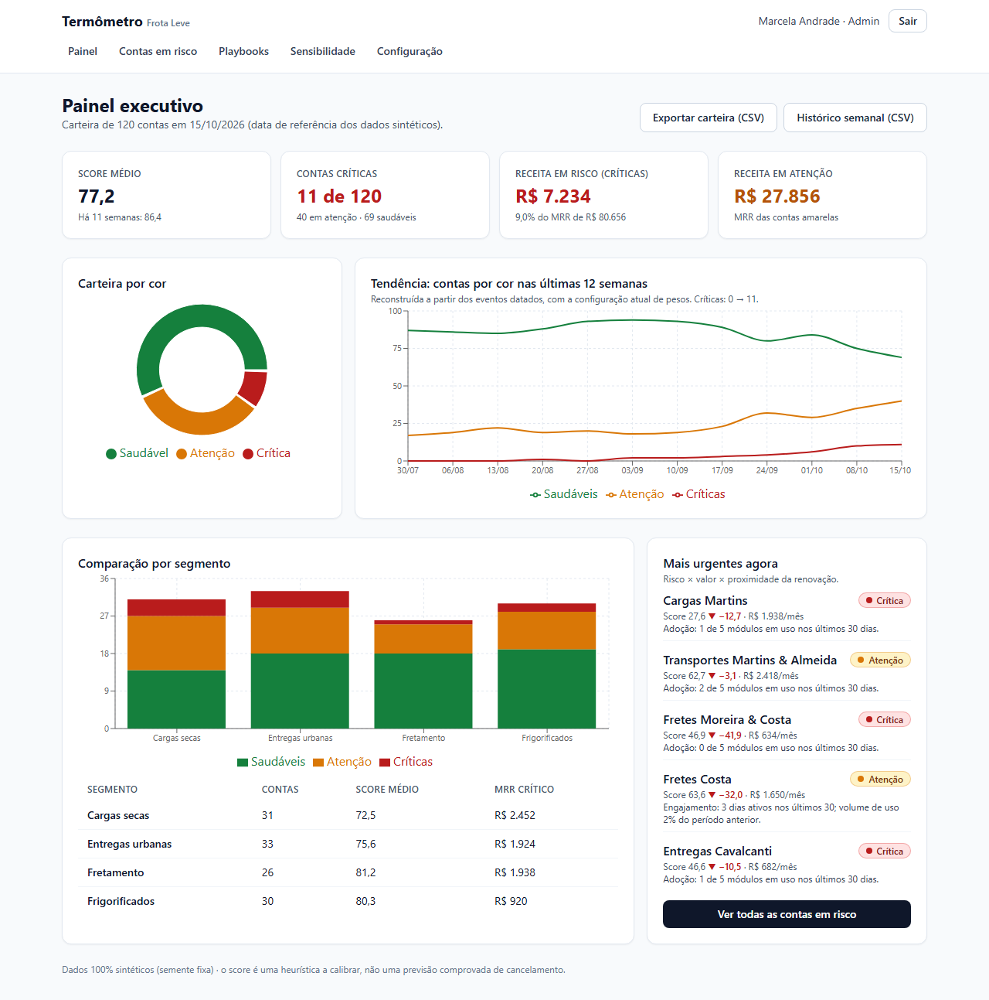
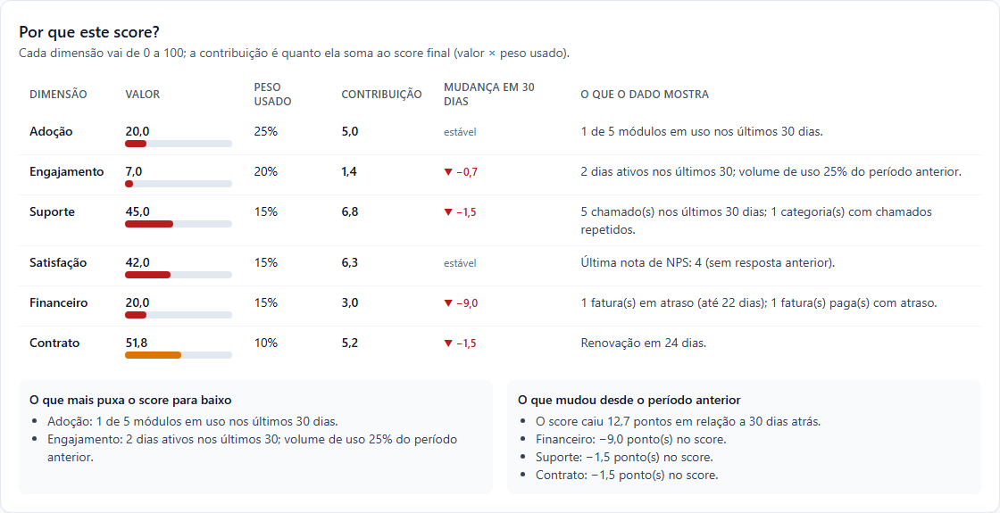
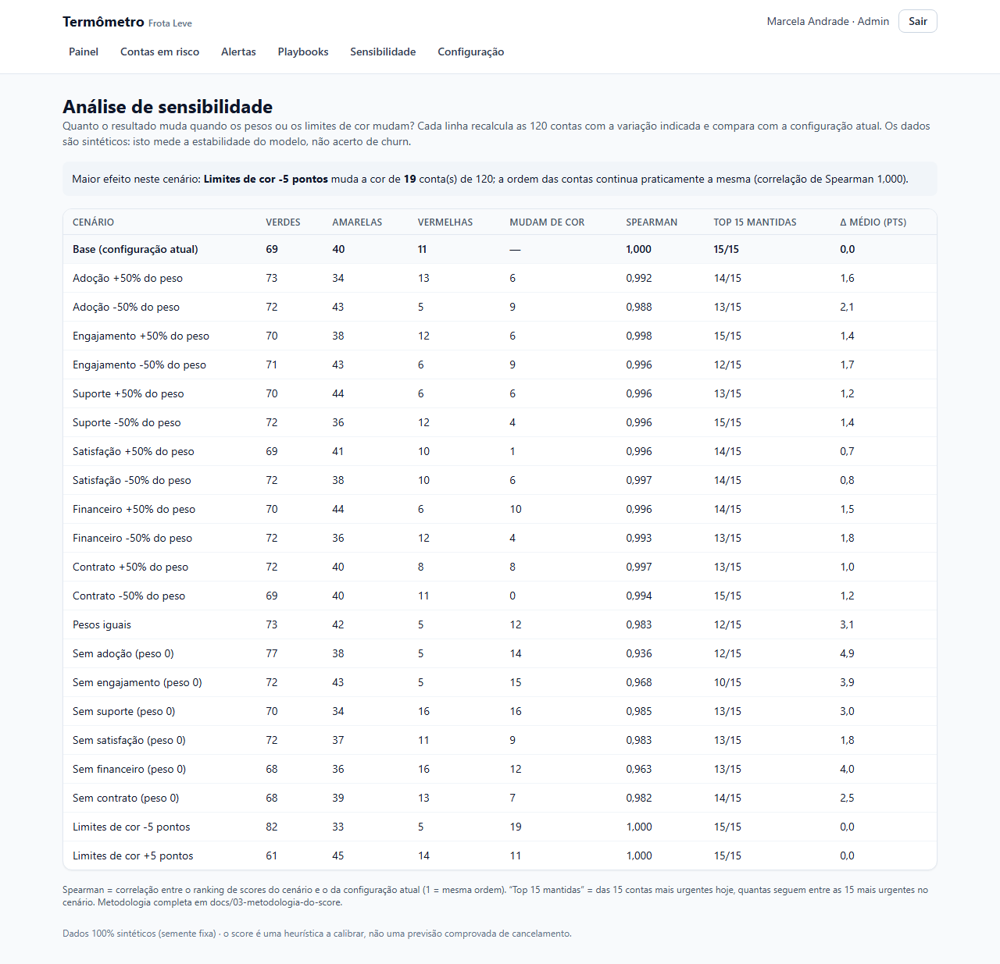
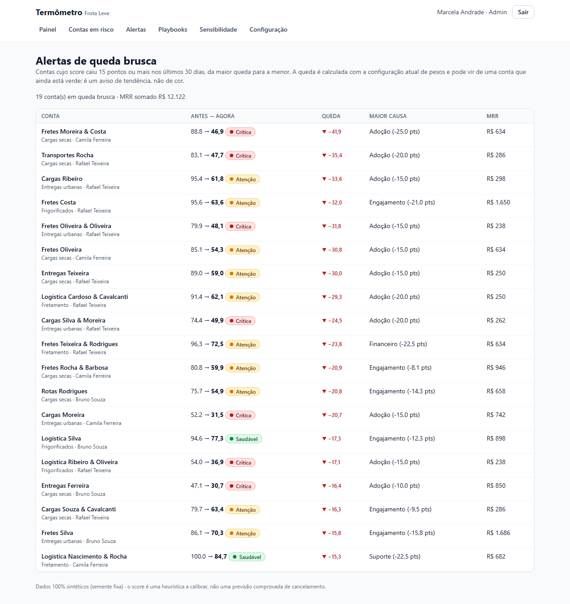
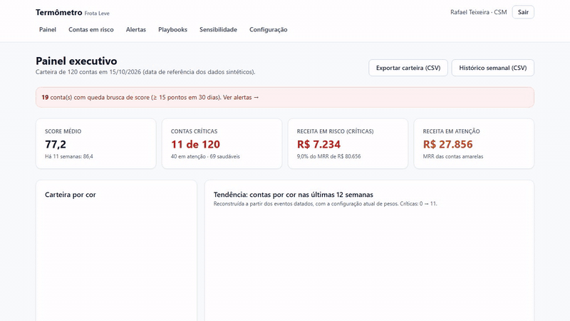

# Termômetro

**Score de saúde de clientes de 0 a 100 em seis dimensões, com explicação por conta, urgência por risco × MRR × renovação, playbooks e alertas de queda.**

## Em 30 segundos

- **Problema** (cenário): na Frota Leve, empresa fictícia, o time de CS (Customer Success, a área que acompanha o cliente depois da venda) só descobre que um cliente esfriou na renovação ou no cancelamento.
- **Solução**: um painel que dá a cada conta um score, mostra de onde ele vem e ordena quem contatar primeiro.
- **Prova**: nos 19 cenários de peso testados, a ordem das contas se mantém estável, com correlação de Spearman de 0,936 a 0,998 ([resultados](docs/03-metodologia-do-score/sensibilidade-resultados.md)). É dado sintético: mede estabilidade, não acerto.
- **Comece por aqui**: [a explicação do score](docs/screenshots/04-explicacao-do-score.png) · [a recusa do "% de chance de cancelar"](docs/04-arquitetura/04-wireframes-e-validacao.md) · [estabilidade não é validade](docs/03-metodologia-do-score/README.md)

Termos e siglas (MRR, Spearman, playbook, QBR): [glossário](docs/GLOSSARIO.md).

## Ficha técnica

| Campo | Situação |
|---|---|
| Natureza | Caso fictício: empresa, pessoas e dados inventados |
| Discovery | Reuniões simuladas, marcadas nas atas |
| Dados | Sintéticos, gerados por script com semente fixa |
| Stack | Next.js e TypeScript (aplicação web), Prisma e PostgreSQL (banco de dados), Vitest e Playwright (testes) |
| Testes | 76 unitários, 5 de integração e 14 de ponta a ponta (E2E) na v1.1.0 (tag `v1.1.0`, commit `ede71b7`, changelog de 2026-10-23); revalidação de 2026-10-24 (commits `d45b65c` e `4598c4c`): os três grupos passaram ([logs](docs/05-qualidade/README.md)) |
| Execução | Local; não hospedado |

## Duas entradas

**Pelo lado do negócio**
- [Episódio 1 · Discovery](docs/01-discovery/README.md): o problema, o brainstorm e as reuniões simuladas.
- [Episódio 2 · Definição](docs/02-definicao/README.md): requisitos, regras, histórias, riscos e rastreabilidade.
- [Episódio 6 · Pós-lançamento](docs/06-pos-lancamento/README.md): retrospectiva, roadmap e a v1.1.

**Pelo lado técnico**
- [Episódio 3 · Metodologia](docs/03-metodologia-do-score/README.md): fórmulas, pesos, sensibilidade e limites.
- [Episódio 4 · Arquitetura](docs/04-arquitetura/README.md): decisões, modelo de dados e desempenho.
- [Episódio 5 · Qualidade](docs/05-qualidade/README.md): testes, aceitação e logs de execução.
- [Complemento Power BI](powerbi/README.md): CSVs e medidas DAX, sem relatório.

<table>
<tr>
<td width="50%"><br><sub>Painel executivo</sub></td>
<td width="50%"><br><sub>Por que este score?</sub></td>
</tr>
<tr>
<td width="50%"><br><sub>Sensibilidade</sub></td>
<td width="50%"><br><sub>Alertas de queda brusca</sub></td>
</tr>
</table>



Fluxo real gravado no app local (23 s, sem narração): painel executivo, contas em risco, a conta mais urgente com "Por que este score?" e os playbooks, e o registro de uma ação. Os 14 prints, na ordem do fluxo de uso, estão na [galeria](docs/screenshots/README.md).

## O problema

Cenário fictício. A Frota Leve vende um sistema de gestão de frotas para pequenas transportadoras e tem 120 clientes. Três pessoas de CS decidem de memória quem contatar. Contas que pararam de usar sem reclamar só aparecem na renovação ([o negócio](docs/01-discovery/02-negocio-frota-leve.md)).

## O que faz

- Calcula um score de 0 a 100 por conta, em seis dimensões, e mostra a cor: verde, amarelo ou vermelho.
- Explica cada score: quanto cada dimensão contribui e o que mudou em 30 dias.
- Ordena as contas por urgência: risco × MRR (receita mensal recorrente) × proximidade da renovação.
- Sugere playbooks (roteiros de contato) com mensagem pronta e registra a ação do CS.
- Avisa quedas de 15 pontos ou mais em 30 dias, permite simular pesos sem gravar e exporta CSV.

## O que este projeto mostra

- Um score explicável por dimensão, com fórmulas, pesos e limites documentados.
- Uma análise de sensibilidade com 22 linhas (21 cenários e o caso-base) que separa estabilidade de validade.
- A recusa justificada de um pedido ("% de chance de cancelar"), com alternativa e condição para mudar.

## Competência → prova

| O que o projeto exercita | Onde está a prova |
|---|---|
| Definir uma métrica e explicar cada ponto dela | [Metodologia](docs/03-metodologia-do-score/README.md) · [print da explicação](docs/screenshots/04-explicacao-do-score.png) |
| Testar a robustez da métrica | [Sensibilidade, 22 linhas](docs/03-metodologia-do-score/sensibilidade-resultados.md) · [print](docs/screenshots/09-sensibilidade.png) |
| Dizer não a um pedido e oferecer alternativa | [Pedido da líder de CS (persona do cliente) na reunião simulada de validação](docs/04-arquitetura/04-wireframes-e-validacao.md) |
| Transformar score em ação | [Regras de negócio](docs/02-definicao/02-regras-de-negocio.md) · [print do playbook na conta](docs/screenshots/05-playbook-na-conta.png) |
| Modelar dados para BI | [Power BI](powerbi/README.md): esquema em estrela, 4 CSVs e medidas DAX; relatório não incluído |
| Declarar o que a métrica não captura | [O que o score não captura](docs/03-metodologia-do-score/README.md#8-o-que-o-score-não-captura) |
| Gerar dados sintéticos reproduzíveis | [Dados sintéticos](docs/00-sobre-este-caso/dados-sinteticos.md) |

## Episódios

| Episódio | O que acontece |
|---|---|
| [0 · Sobre este caso](docs/00-sobre-este-caso/README.md) | Cenário, real × simulado e dados sintéticos |
| [1 · Discovery](docs/01-discovery/README.md) | Brainstorm, negócio e três reuniões simuladas |
| [2 · Definição](docs/02-definicao/README.md) | 14 requisitos funcionais, 17 regras de negócio, 12 histórias, 9 riscos |
| [3 · Metodologia do score](docs/03-metodologia-do-score/README.md) | Fórmulas, pesos, sensibilidade e limitações |
| [4 · Arquitetura](docs/04-arquitetura/README.md) | 6 decisões registradas, modelo de dados, validação e desempenho |
| [5 · Qualidade](docs/05-qualidade/README.md) | Resultados de testes, aceitação e revisões de sprint |
| [6 · Pós-lançamento](docs/06-pos-lancamento/README.md) | Retrospectiva, roadmap e v1.1 |

Guia completo e trilhas de 2, 10 e 30 minutos: [docs/INDEX.md](docs/INDEX.md). Termos e siglas: [glossário](docs/GLOSSARIO.md).

## Decisões que contam

| Decisão | Contexto | Escolha e custo | Quando mudaria |
|---|---|---|---|
| Recusar "% de chance de cancelar" | Pedido da líder de CS (persona do cliente, reunião simulada): "78% de chance de cancelar" por conta, porque "o diretor entende porcentagem". | Recusado: sem histórico de cancelamentos, o percentual seria inventado; o score é heurística; um número "científico" vira verdade (risco R-03). Alternativa: cor, score, motivo principal e urgência em reais. Custo: a líder fica sem um número fácil de apresentar. [Detalhe](docs/04-arquitetura/04-wireframes-e-validacao.md) | Com 12 meses de histórico real de cancelamentos e calibração validada |
| [ADR-001](docs/04-arquitetura/01-adrs.md): calcular em tempo real | Trocar um peso precisa valer na hora. | Tempo real, com cache de 30 s dos dados brutos. Custo: o cálculo cresce com a carteira (carteira ≈ 106 ms, tendência ≈ 800 ms, sensibilidade ≈ 2,8 s). | Acima de alguns milhares de contas ou tendência acima de 2 s |
| [ADR-002](docs/04-arquitetura/01-adrs.md): reconstruir o histórico | A tendência precisa de uma régua só. | Avaliar a função em datas passadas, sem tabela de snapshots. Custo: mais CPU e o histórico muda se um dado antigo for corrigido. | Quando precisar de auditoria do que o painel mostrava |

## Evidências

- **Testes na v1.1.0** (tag `v1.1.0`, commit `ede71b7`, changelog de 2026-10-23): 76 unitários, 5 de integração e 14 E2E passando ([plano e resultados](docs/05-qualidade/01-plano-e-resultados.md)).
- **Revalidação de 2026-10-24**: 76 unitários e 5 de integração passaram (commit `d45b65c`), lint e typecheck sem erro, e os 14 E2E passaram na porta 3101 (commit `4598c4c`). Uma primeira tentativa falhou por porta ocupada; o log foi mantido ([logs](docs/05-qualidade/README.md)).
- **Sensibilidade**: Spearman de 0,936 a 0,998 nos cenários de peso; deslocar os limites de cor em 5 pontos muda a cor de 19 ou de 11 contas ([resultados](docs/03-metodologia-do-score/sensibilidade-resultados.md)).
- **Alertas**: 19 contas em queda brusca na semente padrão, 2 delas ainda saudáveis. Descreve o dado sintético, não o alerta com cancelamento real ([PR da v1.1](docs/06-pos-lancamento/03-pr-v1.1-alerta-queda-brusca.md)).

## O que falta para sair do estudo

- O score é heurística, sem validação contra cancelamento real ([como calibrar](docs/03-metodologia-do-score/README.md#10-como-calibrar-com-dados-reais-próximo-passo)).
- Os dados são sintéticos ([dados sintéticos](docs/00-sobre-este-caso/dados-sinteticos.md)).
- O relatório do Power BI não foi montado ([Power BI](powerbi/README.md)).
- Histórico de configuração, selo de renovação, QBR (relatório de acompanhamento por conta) e alertas por e-mail só existem no [roadmap](docs/06-pos-lancamento/02-roadmap.md).
- Cobertura de testes, acessibilidade e carga não foram medidas ([limites da cobertura](docs/05-qualidade/01-plano-e-resultados.md)).

## Rodar localmente

Pré-requisitos: Node 20+ e Docker (para o PostgreSQL).

```bash
git clone https://github.com/Joaogabrielmaia/Customer-Health.git
cd Customer-Health
npm install
cp .env.example .env          # defina AUTH_SECRET com um valor aleatório de 32+ caracteres
npm run db:up                 # PostgreSQL na porta 5440 (Docker Compose)
npm run db:migrate            # cria as tabelas
npm run db:seed               # gera os dados sintéticos (semente fixa)
npm run dev                   # abre em http://localhost:3100
```

Usuários fictícios, todos com a senha `Termometro@2026`, válida só para estes dados locais: `marcela@frotaleve.example` (Admin) e `rafael@frotaleve.example`, `camila@frotaleve.example`, `bruno@frotaleve.example` (CSM). Outros comandos: `npm test`, `npm run test:integration`, `npm run test:e2e`, `npm run sensitivity`, `npm run bench`, `npm run export:powerbi`.

## Limites

- O score é uma heurística: pesos e limites são escolhas fundamentadas, não estimativas, e não preveem cancelamento.
- Os dados são sintéticos e vêm de arquétipos desenhados no estudo; "o score separa bem os arquétipos" não é validação.
- As reuniões são simuladas; a empresa e as pessoas são fictícias.
- O score não captura motivo qualitativo, concorrência, relacionamento, sazonalidade nem valor estratégico ([lista completa](docs/03-metodologia-do-score/README.md#8-o-que-o-score-não-captura)).
- Desempenho medido só com 120 contas; segurança de nível de demonstração local, sem recuperação de senha, MFA ou limite de tentativas.
- O relatório do Power BI não foi montado; cobertura, acessibilidade e carga não foram medidas; não há hospedagem.

Licença [MIT](LICENSE).
