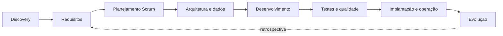
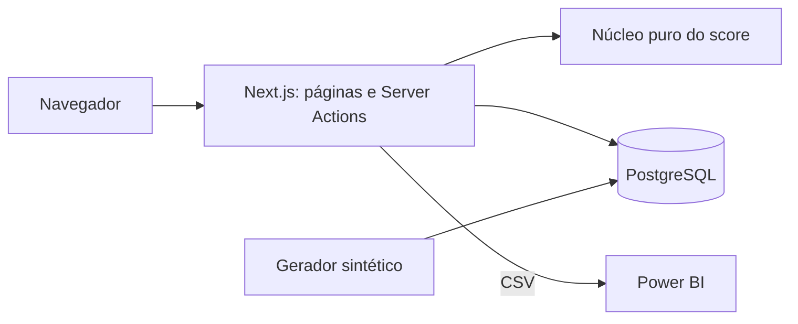
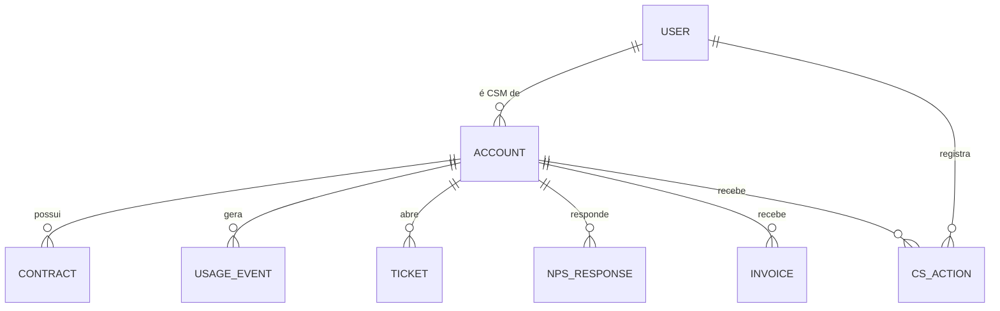
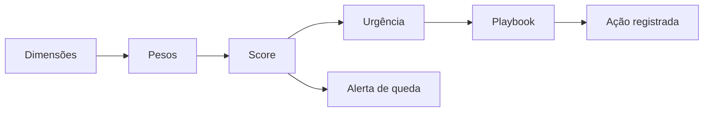

# Termômetro

**Score de saúde de clientes de 0 a 100 em seis dimensões, com explicação por conta, urgência por risco × MRR × renovação, playbooks e alertas de queda.**

Relatório do ciclo de vida de uma solução analítica para Customer Success, do discovery à evolução da versão 1.1.0. O repositório reúne o produto, os documentos de cada fase e as evidências de execução.

## Problema e solução

Cenário fictício: a Frota Leve vende um sistema de gestão de frotas para pequenas transportadoras e tem 120 clientes. Três pessoas de CS (Customer Success, a área que acompanha o cliente depois da venda) decidem de memória quem contatar. A conta que para de usar sem reclamar só aparece na renovação ([o negócio](docs/01-discovery/02-negocio-frota-leve.md)).

O Termômetro dá a cada conta um score explicável, ordena as contas por urgência e entrega o próximo passo (playbook) e o registro da ação. O score é uma heurística de sinais; o sistema não estima probabilidade de cancelamento.

## Demonstração

<table>
<tr>
<td width="50%"> Painel executivo</td>
<td width="50%"> Por que este score?</td>
</tr>
<tr>
<td width="50%"> Sensibilidade</td>
<td width="50%"> Alertas de queda brusca</td>
</tr>
</table>

A gravação mostra o fluxo real no app (23 s, sem narração). Os 14 prints, na ordem de uso, estão na [galeria](docs/screenshots/README.md).

## Ficha técnica

| Campo | Situação |
|---|---|
| Natureza | Estudo de caso fictício: empresa, pessoas e dados inventados; dados sintéticos e reuniões simuladas |
| Stack | Next.js e TypeScript (aplicação web), Prisma e PostgreSQL (banco), Vitest e Playwright (testes) |
| Testes | 76 unitários e 5 de integração em 2026-10-24 (commit `d45b65c`); 14 de ponta a ponta em 2026-10-24 (commit `4598c4c`) |
| Versões | `v1.0.0` e `v1.1.0` (tags de 2026-10-23); correção da porta do Playwright ainda não lançada |

## Principais funcionalidades

- Score de 0 a 100 em seis dimensões (adoção, engajamento, suporte, satisfação, financeiro e contrato), com contribuição e causa por conta.
- Urgência que combina risco, MRR (receita mensal recorrente) e proximidade da renovação, na lista de contas em risco.
- Cinco playbooks (roteiros de contato) com mensagem já preenchida, e registro de ação que grava o score e a cor do momento.
- Configuração de pesos e limites com simulação antes de salvar (só o Admin salva).
- Análise de sensibilidade: 21 cenários mais o caso-base, com correlação de Spearman (medida de quanto duas ordenações se parecem).
- Alerta de queda de 15 pontos ou mais em 30 dias (v1.1.0), exportação em CSV e quatro CSVs com medidas DAX para Power BI (o relatório não está montado).

## Ciclo de vida: do discovery à evolução

| Fase | Documento |
|---|---|
| Descoberta e problema | [Visão e discovery](docs/ciclo-de-vida/01-visao-e-discovery.md) |
| Planejamento e Scrum | [Planejamento e Scrum](docs/ciclo-de-vida/02-planejamento-e-scrum.md) |
| Requisitos | [Requisitos e rastreabilidade](docs/ciclo-de-vida/03-requisitos-e-rastreabilidade.md) |
| Arquitetura | [Arquitetura e ADRs](docs/ciclo-de-vida/04-arquitetura-e-adrs.md) |
| Banco de dados | [Modelo de dados](docs/ciclo-de-vida/05-modelo-de-dados.md) |
| Desenvolvimento | [Desenvolvimento e configuração](docs/ciclo-de-vida/06-desenvolvimento-e-configuracao.md) |
| Testes | [Testes e qualidade](docs/ciclo-de-vida/07-testes-e-qualidade.md) |
| Implantação | [Implantação e operação](docs/ciclo-de-vida/08-implantacao-e-operacao.md) |
| Evolução | [Evolução e roadmap](docs/ciclo-de-vida/09-evolucao-e-roadmap.md) |
| Regras do score | [Regras analíticas do score](docs/ciclo-de-vida/10-regras-analiticas-do-score.md) |

## Linha do tempo e marcos

Os commits e as tags estão concentrados em 2026-10-23 e 2026-10-24. O calendário abaixo é do cenário e organiza o planejamento; não reconstrói as datas dos commits.

| Marco | Calendário do cenário | Registro observado no Git |
|---|---|---|
| Discovery e definição | 07/09 a 18/09/2026 | Documentos de definição, antes do código |
| Sprints 1 a 3 | 21/09 a 09/10/2026 | Modelo de dados, motor, fluxo do CS, pesos, sensibilidade, testes (2026-10-23) |
| Release `v1.0.0` | Fim da estabilização | Tag de 2026-10-23 |
| Sprint 4 · alerta de queda | 19/10 a 23/10/2026 | Tag `v1.1.0` de 2026-10-23 |
| Revalidação | — | Logs de 2026-10-24 |

## Scrum e planejamento

Product Goal: dar ao time de CS uma ordem de contato explicável, sem prometer previsão de cancelamento. O backlog é priorizado pelo MoSCoW e pela dependência técnica, em duas releases e quatro sprints, com Definition of Ready e Definition of Done.

| Sprint | Objetivo | Entrega |
|---|---|---|
| [1](docs/ciclo-de-vida/sprints/sprint-1.md) | Motor do score testado e banco populado | 71 testes unitários ao fim |
| [2](docs/ciclo-de-vida/sprints/sprint-2.md) | Fluxo painel → conta → porquê → ação | Fluxo completo e 5 testes de integração |
| [3](docs/ciclo-de-vida/sprints/sprint-3.md) | Pesos, sensibilidade, CSV e E2E | `v1.0.0` com 13 E2E e 13 prints |
| [4](docs/ciclo-de-vida/sprints/sprint-4.md) | Alerta de queda brusca | `v1.1.0` com 76 unitários e 14 E2E |

Não há story points, velocity nem burndown medidos.

## Reuniões e decisões com o cliente

Seis atas simuladas, com participantes por papel: três de discovery, validação de wireframes, aceitação e retrospectiva ([índice](docs/ciclo-de-vida/reunioes/README.md)). A validação decidiu oito pedidos: cinco aceitos, um adiado, um parcial e um recusado.

| Item | Registro |
|---|---|
| Pedido | A líder de CS (persona do cliente) pediu "78% de chance de cancelar" por conta, porque "o diretor entende porcentagem" |
| Alternativas | Mostrar o percentual; ou mostrar cor, score, motivo principal e urgência em reais |
| Decisão | Recusa do percentual: sem histórico de cancelamentos ele seria inventado, o score é uma heurística e um número "científico" vira verdade (risco R-03). Foram oferecidos cor, score, motivo principal e urgência em reais |
| Custo aceito | A líder fica sem um número fácil de apresentar |
| Quando mudaria | Com 12 meses de histórico real de cancelamentos e calibração validada |

Registro completo: [wireframes e validação](docs/04-arquitetura/04-wireframes-e-validacao.md).

## Requisitos e rastreabilidade

14 requisitos funcionais, 7 não funcionais, 17 regras de negócio e 12 histórias com critérios de aceite. Cada necessidade do cliente se liga a requisito, regra, código e teste: [requisitos e rastreabilidade](docs/ciclo-de-vida/03-requisitos-e-rastreabilidade.md) e a [tabela de 15 linhas](docs/02-definicao/06-rastreabilidade.md).

## Arquitetura e decisões técnicas

O núcleo do score é puro (sem banco nem framework), e as telas, as ações do servidor e os scripts o reutilizam.

Seis ADRs registram contexto, alternativas, escolha e trade-off: [ADRs](docs/04-arquitetura/01-adrs.md) e [arquitetura do ciclo de vida](docs/ciclo-de-vida/04-arquitetura-e-adrs.md), com diagramas de contexto, contêineres, sequência e estados. Duas decisões se destacam: cálculo em tempo real (ADR-001) e histórico reconstruído em vez de snapshots (ADR-002).

## Modelo de dados e banco

Nove tabelas e cinco enumerações em PostgreSQL, uma migração (`init`), uso agregado por dia e módulo e dados de demonstração reproduzíveis (semente 20261015: 120 contas, 41.578 registros de uso, 504 chamados, 184 NPS, 805 faturas, 64 ações).

Dicionário, índices, esquema estrela do Power BI e a explicação do valor 1.355 (12 × 120 menos 85 pares em que a conta ainda não existia) estão em [modelo de dados](docs/ciclo-de-vida/05-modelo-de-dados.md).

## Fluxo principal do sistema

Fórmulas, janelas, pesos e limites, com um exemplo de leitura: [regras analíticas do score](docs/ciclo-de-vida/10-regras-analiticas-do-score.md).

## Estratégia de testes e evidências de qualidade

Pirâmide com 76 testes unitários (regras, limites e dado ausente), 5 de integração com PostgreSQL real e 14 de ponta a ponta, mais lint e verificação de tipos. A [estratégia](docs/ciclo-de-vida/07-testes-e-qualidade.md) lista casos positivos, negativos, limites e regressão, e os casos propostos que ainda não existem.

- **Testes:** 76 unitários e 5 de integração em 2026-10-24 (commit `d45b65c`); 14 E2E em 2026-10-24 (commit `4598c4c`). Saídas em [docs/05-qualidade](docs/05-qualidade/README.md).
- **Sensibilidade:** 22 linhas (21 cenários e o caso-base), semente 20261015 ([resultados](docs/03-metodologia-do-score/sensibilidade-resultados.md), commit `dba5229`, 2026-10-23).
- **Alertas:** 19 contas em queda brusca na semente padrão, 2 delas ainda saudáveis (v1.1.0, 2026-10-23); descreve o dado sintético, não o alerta com cancelamento real ([PR](docs/06-pos-lancamento/03-pr-v1.1-alerta-queda-brusca.md)).
- **Defeitos:** seis registrados com causa e correção, entre eles um defeito do gerador achado por teste.

## Implantação, operação e adoção

O produto roda apenas em ambiente local; não há deploy, hospedagem nem monitoramento. O [plano](docs/ciclo-de-vida/08-implantacao-e-operacao.md) descreve, como planejamento não executado, os ambientes, o rollout em piloto, o rollback, a migração de dados reais, o treinamento e os indicadores de adoção. Nenhum indicador de adoção foi medido.

## Gestão de configuração e evolução

Conventional Commits com o ID do requisito, versionamento semântico, CHANGELOG e releases para as duas tags. O repositório não tem CI nem proteção de branch comprovada; a verificação é local ([desenvolvimento e configuração](docs/ciclo-de-vida/06-desenvolvimento-e-configuracao.md)). A v1.1.0 só acrescentou funcionalidade, sem mudar o schema. A [evolução](docs/ciclo-de-vida/09-evolucao-e-roadmap.md) traz solicitações de mudança, problemas, dívida técnica e roadmap.

## Competência → evidência

| Competência | Onde está a evidência |
|---|---|
| Discovery e relacionamento com o cliente | [Visão e discovery](docs/ciclo-de-vida/01-visao-e-discovery.md) · [atas](docs/ciclo-de-vida/reunioes/README.md) |
| Gerenciamento de projeto e Scrum | [Planejamento e Scrum](docs/ciclo-de-vida/02-planejamento-e-scrum.md) · [sprints](docs/ciclo-de-vida/sprints/README.md) |
| Engenharia de requisitos e rastreabilidade | [Requisitos e rastreabilidade](docs/ciclo-de-vida/03-requisitos-e-rastreabilidade.md) · [tabela de 15 linhas](docs/02-definicao/06-rastreabilidade.md) |
| Definir uma métrica e explicar cada ponto | [Regras analíticas](docs/ciclo-de-vida/10-regras-analiticas-do-score.md) · [metodologia](docs/03-metodologia-do-score/README.md) · [print](docs/screenshots/04-explicacao-do-score.png) |
| Testar a robustez da métrica | [Sensibilidade, 22 linhas](docs/03-metodologia-do-score/sensibilidade-resultados.md) · [print](docs/screenshots/09-sensibilidade.png) |
| Dizer não a um pedido e oferecer alternativa | [Recusa do "% de chance de cancelar"](docs/04-arquitetura/04-wireframes-e-validacao.md) |
| Arquitetura e decisões técnicas | [Arquitetura e ADRs](docs/ciclo-de-vida/04-arquitetura-e-adrs.md) · [ADRs](docs/04-arquitetura/01-adrs.md) |
| Modelagem de dados e BI | [Modelo de dados](docs/ciclo-de-vida/05-modelo-de-dados.md) · [Power BI](powerbi/README.md) |
| Dados sintéticos reproduzíveis | [Dados sintéticos](docs/00-sobre-este-caso/dados-sinteticos.md) |
| Qualidade e testes | [Testes e qualidade](docs/ciclo-de-vida/07-testes-e-qualidade.md) · [logs](docs/05-qualidade/README.md) |
| Declarar o que a métrica não captura | [O que o score não captura](docs/03-metodologia-do-score/README.md#8-o-que-o-score-não-captura) |
| Implantação e evolução | [Implantação e operação](docs/ciclo-de-vida/08-implantacao-e-operacao.md) · [Evolução e roadmap](docs/ciclo-de-vida/09-evolucao-e-roadmap.md) |

## Limitações, riscos e evolução prevista

- O score é uma heurística sem validação contra cancelamento real, e os dados são sintéticos, gerados por arquétipos desenhados no estudo; "o score separa bem os arquétipos" não é validação.
- O relatório do Power BI não foi montado; só os CSVs e as medidas DAX estão no repositório.
- Cobertura de testes, acessibilidade e carga não foram medidas; o desempenho foi medido só com 120 contas e a segurança é de demonstração, sem recuperação de senha, MFA ou limite de tentativas.
- Não há CI, deploy, monitoramento nem indicadores de adoção.
- A reunião 2 cita cerca de 12 contatos por dia e a reunião 1, cerca de 15 por semana por CSM; a documentação segue a [reunião 1](docs/01-discovery/03-reuniao-lider-de-cs.md).
- O print 07 mostra uma ação com data de captura de 23/10/2026, enquanto a data de referência dos dados é 15/10/2026; a [legenda](docs/screenshots/README.md) explica.

Evolução prevista, detalhada no [roadmap](docs/06-pos-lancamento/02-roadmap.md): histórico de configurações, zona cinzenta e selo de renovação (v1.2); QBR por conta (v1.3); calibração com dados reais e alertas por e-mail (v2.0).

## Índice dos documentos complementares

- [Ciclo de vida](docs/ciclo-de-vida/README.md): índice, linha do tempo e os dez documentos.
- [Guia da série](docs/INDEX.md) e [glossário](docs/GLOSSARIO.md).
- Episódios: [0 Sobre este caso](docs/00-sobre-este-caso/README.md), [1 Discovery](docs/01-discovery/README.md), [2 Definição](docs/02-definicao/README.md), [3 Metodologia](docs/03-metodologia-do-score/README.md), [4 Arquitetura](docs/04-arquitetura/README.md), [5 Qualidade](docs/05-qualidade/README.md), [6 Pós-lançamento](docs/06-pos-lancamento/README.md).
- [Diagramas](docs/ciclo-de-vida/diagramas/README.md) e [CHANGELOG](CHANGELOG.md).

## Nota de contexto acadêmico

Este projeto é um estudo de caso acadêmico, com dados, empresas e atividades de gestão simulados.

A IA generativa (Claude, da Anthropic) foi utilizada como apoio ao desenvolvimento e à documentação. As decisões e os resultados foram revisados pelo autor, e os testes citados seguem as evidências registradas.

## Licença

[MIT](LICENSE).
