# Termômetro · saúde dos clientes

**Um painel que mostra a saúde de cada cliente de um SaaS (verde, amarelo e vermelho), explica por que ela está assim e indica o que o time de Customer Success deve fazer.**


| Contas em risco, por urgência | Por que este score? |
|---|---|
| 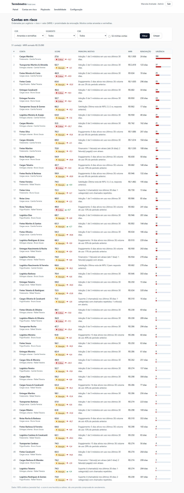 |  |

> **Estudo de caso com dados sintéticos e reuniões simuladas.** Não existe cliente real, operação real nem ambiente de produção. O score é uma **heurística**, não uma previsão comprovada de cancelamento. Detalhes em [Limitações honestas](#limitações-honestas).

---

## Resumo em 5 linhas
1. Sou o João Gabriel Maia da Costa (Engenharia de Software, PUC Minas) e construí este estudo de caso do discovery à entrega para mostrar como penso Customer Success.
2. O caso é a **Frota Leve**, SaaS fictício de gestão de frotas com 120 clientes e um CS de 3 pessoas que hoje decide "quem contatar" de cabeça.
3. O **Termômetro** calcula um score de 0 a 100 em seis dimensões (adoção, engajamento, suporte, satisfação, financeiro e contrato), mostra a contribuição de cada uma e ordena as contas por urgência (risco × valor × renovação).
4. O diferencial é a **transparência**: score simples, documentado, configurável, testado e com análise de sensibilidade (71 testes unitários, 5 de integração e 13 E2E, todos executados).
5. Tudo roda local (Next.js, Prisma, PostgreSQL em Docker); as provas são documentos e 13 prints.

## Como o discovery foi feito e de onde vêm os dados
- **Discovery simulado.** Fiz três reuniões (líder de CS, CSM e dono de transportadora) em que **o Claude interpretou o cliente**. Cada registro começa com *"Simulação: o Claude interpretou o cliente nesta conversa."* As contradições (a líder quer um número só, o CSM quer contexto), os pedidos vagos que refinei e a restrição que mudou o escopo (15 contatos por semana por CSM) estão em [docs/01-discovery](docs/01-discovery/).
- **Dados sintéticos.** Uso, chamados, NPS e faturas são gerados por [um script com semente fixa](scripts/seed/generate.ts) (120 contas, 41.578 registros de uso, 504 chamados, 184 NPS, 805 faturas). Como e por quê: [dados-sinteticos.md](docs/00-sobre-este-caso/dados-sinteticos.md).
- Se eu tiver anotações de uma conversa real (com autorização), elas substituem a simulação correspondente.

## Mapa do repositório

| Pasta / arquivo | O que tem |
|---|---|
| [`docs/INDEX.md`](docs/INDEX.md) | Índice de todos os documentos |
| [`docs/00-sobre-este-caso`](docs/00-sobre-este-caso/) | Regras de integridade e como os dados sintéticos são gerados |
| [`docs/01-discovery`](docs/01-discovery/) | Brainstorm e matriz de decisão, negócio, 3 reuniões simuladas, processo AS-IS e definição de saúde e risco |
| [`docs/02-definicao`](docs/02-definicao/) | Requisitos (RF/RNF), regras de negócio, histórias com critérios de aceite, MoSCoW, backlog em 3 sprints, riscos, rastreabilidade |
| [`docs/03-metodologia-do-score`](docs/03-metodologia-do-score/) | **Documento central**: fórmulas, pesos, limites, dados ausentes, limitações e sensibilidade real |
| [`docs/04-arquitetura`](docs/04-arquitetura/) | ADRs, modelo ER, componentes, wireframes, reunião de validação (com recusa), desempenho medido |
| [`docs/05-qualidade`](docs/05-qualidade/) | Resultados reais dos testes, reunião de aceitação, revisão de cada sprint |
| [`docs/06-pos-lancamento`](docs/06-pos-lancamento/) | Retrospectiva, roadmap, v1.1 (PR, changelog) e retrospectiva final |
| [`docs/screenshots`](docs/screenshots/) | 13 prints numerados gerados com Playwright |
| [`docs/entrevista`](docs/entrevista/) · [`docs/vitrine`](docs/vitrine/) | Perguntas de entrevista (3 por fase) · bullets de currículo, post e respostas de 30 s e 2 min |
| [`powerbi/`](powerbi/) | CSVs, modelo de dados, medidas DAX e passo a passo para Power BI |
| [`src/lib/score`](src/lib/score/) | Motor do score (funções puras e tipadas) |
| [`src/app`](src/app/) · [`src/components`](src/components/) | Telas, ações de servidor e componentes |
| [`scripts/`](scripts/) | Gerador de dados, sensibilidade, benchmark, export Power BI |
| [`prisma/`](prisma/) | Schema e migrações do PostgreSQL |
| [`tests/`](tests/) | Unitários, integração (banco real) e E2E (Playwright) |

## Roteiro de leitura em 7 passos
1. **Discovery** → [matriz de decisão](docs/01-discovery/01-brainstorm-e-decisao.md), [reunião com a líder](docs/01-discovery/03-reuniao-lider-de-cs.md), [com o CSM](docs/01-discovery/04-reuniao-csm.md) e [processo AS-IS e definições](docs/01-discovery/05-processo-as-is-e-definicoes.md).
2. **Requisitos** → [requisitos](docs/02-definicao/01-requisitos.md), [regras de negócio](docs/02-definicao/02-regras-de-negocio.md) e [rastreabilidade](docs/02-definicao/06-rastreabilidade.md).
3. **Metodologia do score** → [o documento central](docs/03-metodologia-do-score/README.md) e a [tabela de sensibilidade](docs/03-metodologia-do-score/sensibilidade-resultados.md).
4. **Decisões** → [ADRs](docs/04-arquitetura/01-adrs.md) e a [reunião de validação com a recusa justificada](docs/04-arquitetura/04-wireframes-e-validacao.md).
5. **Modelo** → [modelo ER](docs/04-arquitetura/02-modelo-er.md) e [componentes](docs/04-arquitetura/03-componentes.md).
6. **Qualidade** → [resultados reais dos testes](docs/05-qualidade/01-plano-e-resultados.md) e a [reunião de aceitação](docs/05-qualidade/02-reuniao-de-aceitacao.md).
7. **Evolução** → [retrospectiva](docs/06-pos-lancamento/01-reuniao-de-retrospectiva.md), [roadmap](docs/06-pos-lancamento/02-roadmap.md) e a [v1.1](CHANGELOG.md).

---

## O score em uma página

Cada dimensão vai de 0 a 100 (maior = mais saudável). O score é a **soma ponderada** das dimensões que têm dado.

| Dimensão | Peso | Como é calculada (resumo) | Por que esse peso |
|---|---:|---|---|
| Adoção | 25 | Módulos em uso (≥ 4 eventos em 30 dias) ÷ 5 | Sinal mais cedo e mais acionável |
| Engajamento | 20 | 70% dias ativos (meta 20 em 30) + 30% tendência vs. 30 dias antes | Pega o "esfriamento" |
| Suporte | 15 | 100 − penalidades (chamados recentes, categoria repetida, crítico aberto, chamado envelhecido) | Problema repetido corrói confiança |
| Satisfação | 15 | 80% nota de NPS × 10 + 20% tendência (janela de 180 dias) | Direto, mas trimestral |
| Financeiro | 15 | 100 − penalidades (atraso pago, fatura vencida em aberto) | Atraso é sinal forte, mas ambíguo |
| Contrato | 10 | 100 com 120+ dias para renovar; cai a 40 no vencimento; vencido = 20 | Marca o momento de decisão, não a insatisfação |

- **Cores** (configuráveis): verde ≥ 75; amarelo 50 a 74,9; vermelho < 50.
- **Dado ausente**: a dimensão sai do cálculo e os pesos são renormalizados (conta nova, sem NPS, sem fatura). Com menos de 70% do peso disponível, a tela avisa **confiança baixa**.
- **Urgência** = `(100 − score)/100 × MRR × proximidade da renovação` (de 1 a 2). Responde à restrição de 15 contatos por semana por CSM.
- **Explicação**: contribuição de cada dimensão e comparação com 30 dias atrás, com a mesma configuração.
- **Sensibilidade real** (22 cenários, 120 contas sintéticas): a **ordem** das contas é estável (Spearman entre 0,936 e 0,998), mas a **cor** é sensível aos limites (deslocar 5 pontos muda a cor de 19 ou 11 contas). Leitura: priorizar pela urgência e tratar a fronteira como zona cinzenta.

Tudo, com fórmulas completas e limitações: [metodologia do score](docs/03-metodologia-do-score/README.md).

---

## Tour pelo sistema

### Painel executivo

Carteira por cor, receita em risco (MRR das críticas e das amarelas), tendência de 12 semanas, comparação por segmento, as 5 contas mais urgentes e exportação em CSV.
**Decisão:** mostrar só agregados aqui; o número individual sem explicação é exatamente o que o CSM pediu para evitar. A tendência é **reconstruída** a partir de eventos datados (ADR-002), não gravada.

### Contas em risco

Amarelas e vermelhas ordenadas por urgência, com filtros (cor, segmento, CSM, "só minhas"), principal motivo em uma frase, renovação e barra de urgência.
**Decisão:** ordenar por urgência em vez de só por score, porque cada CSM só consegue conduzir cerca de 15 contatos por semana (restrição da reunião 1).

### Visão da conta
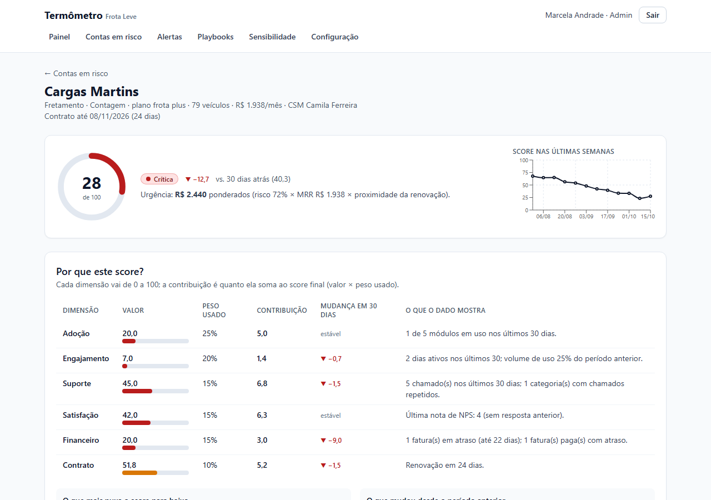
Dial do score, variação em 30 dias, aviso de confiança baixa, histórico de 12 semanas, playbooks, registro de ação e linha do tempo (chamados, NPS, faturas e ações).

### Explicação do score

Valor, peso usado, contribuição e mudança em 30 dias de cada dimensão, mais "o que mais puxa para baixo" e "o que mudou".
**Decisão:** o número em destaque e o porquê logo abaixo resolve a contradição entre a líder (um número só) e o CSM (contexto).

### Playbooks de CS
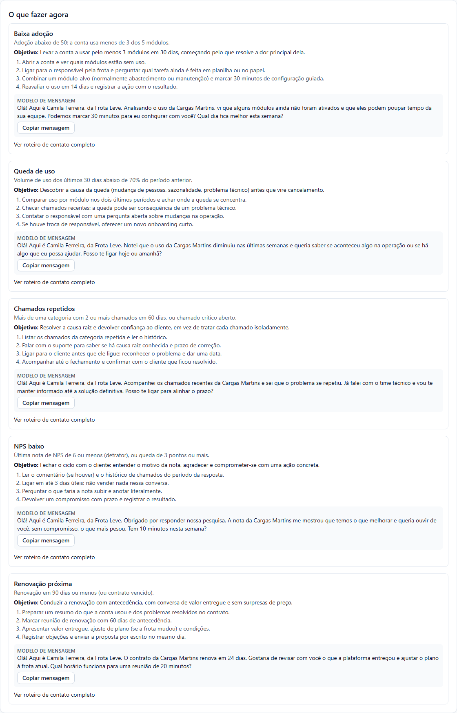
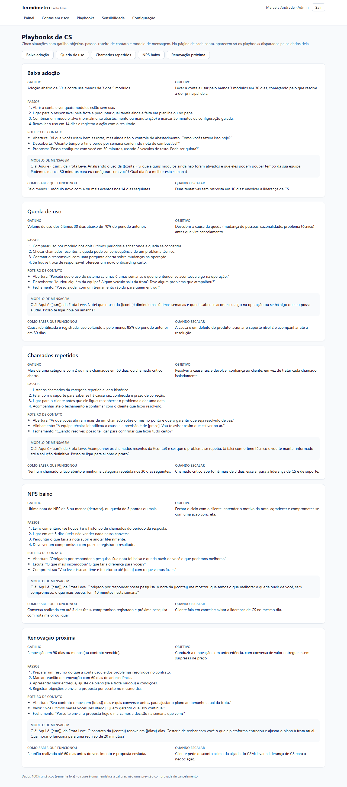
Cinco playbooks (baixa adoção, queda de uso, chamados repetidos, NPS baixo, renovação próxima), cada um com **gatilho objetivo, passos, roteiro de contato, modelo de mensagem, critério de sucesso e quando escalar**. Na conta aparecem só os disparados pelos dados dela, com a mensagem já preenchida e botão copiar.
**Decisão:** gatilhos por regra (RN-12), não por palpite; o roteiro nunca pergunta "está tudo bem?", porque o cliente-tipo disse que não atenderia.

### Registro de ação do CS

Canal, playbook, resultado e nota, gravando o score e a cor do momento.
**Decisão:** é o **único** registro manual do sistema; o CSM disse que abandonaria qualquer ferramenta que exigisse mais digitação.

### Configuração de pesos
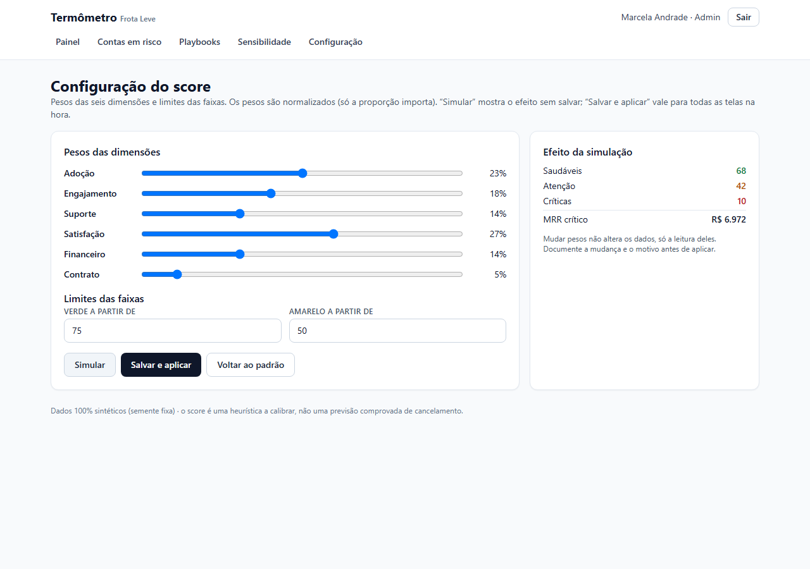
Pesos e limites ajustáveis, com **simulação sem gravar** e **efeito imediato** ao salvar (só Admin). Valida peso negativo, soma zero e limites invertidos.
**Decisão:** a simulação existe porque mudar a régua muda toda a leitura da carteira (risco R-05).

### Análise de sensibilidade

22 cenários recalculados na hora: mudança de cor, correlação de ranking (Spearman), permanência do top 15 e variação média.

### Exportação
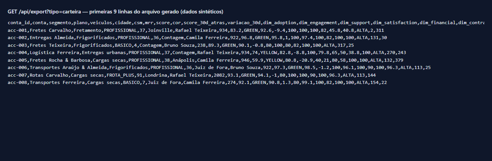
CSV da carteira, do histórico semanal e das ações (UTF-8 com BOM). O print mostra as primeiras linhas do arquivo realmente gerado.

### Versão mobile
| Painel | Conta |
|---|---|
| 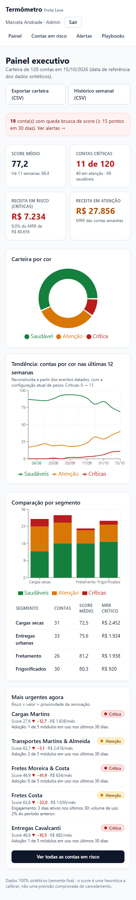 | 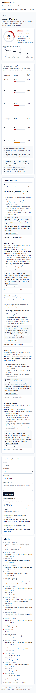 |

Layout em 390 px sem rolagem horizontal da página (testado); tabelas largas rolam por dentro.

### Login
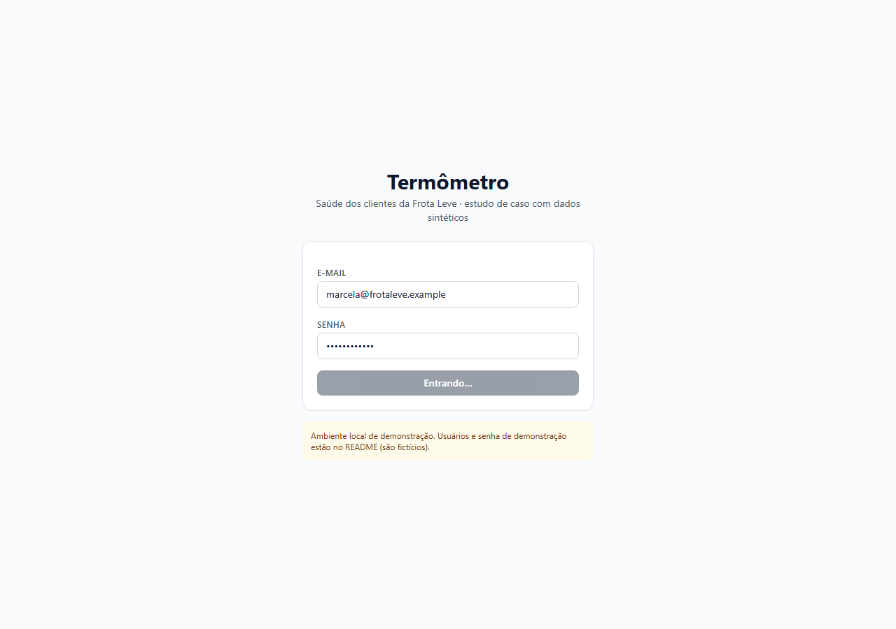

---

## As 5 decisões mais importantes e seus trade-offs

| # | Decisão | Trade-off | Mudaria se… |
|---|---|---|---|
| 1 | **Score simples e explicável** (soma ponderada de 6 dimensões) em vez de modelo estatístico | Perde poder de predição; ganha confiança e auditabilidade | Houver histórico real de cancelamento para calibrar ou treinar |
| 2 | **Recusar "chance de cancelar em %"** | A líder perde um número "fácil de apresentar" | Houver 12 meses de histórico e calibração validada |
| 3 | **Cálculo em tempo real** e histórico reconstruído (ADR-001/002) | Custo cresce com a carteira (carteira ≈ 106 ms, tendência ≈ 800 ms, sensibilidade ≈ 2,8 s) | Passar de alguns milhares de contas: snapshots semanais |
| 4 | **Dado ausente sai do cálculo** (e a confiança é sinalizada) em vez de virar nota 0 | Conta com pouco dado tem score menos confiável | Surgirem dados que justifiquem imputação |
| 5 | **Dados sintéticos por arquétipos com semente fixa** | Circularidade: o modelo "acerta" o que eu desenhei | Eu receber um export real e anonimizado |

Todas as decisões, com contexto e alternativas, estão nos [ADRs](docs/04-arquitetura/01-adrs.md).

## Arquitetura e modelo de dados

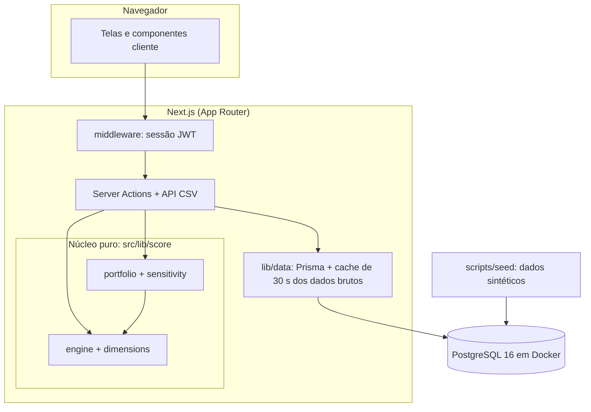

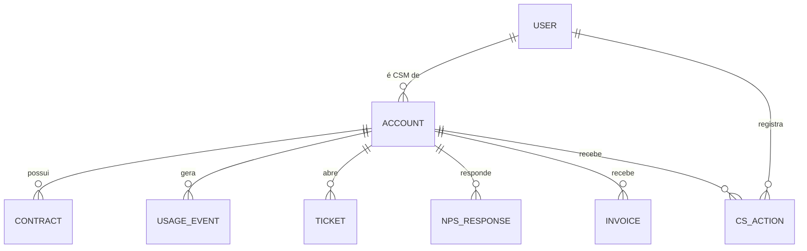
Modelo completo com campos: [modelo ER](docs/04-arquitetura/02-modelo-er.md).

## Qualidade (execução real)

| Comando | Resultado |
|---|---|
| `npm run lint` | sem erros nem avisos |
| `npm run typecheck` | sem erros |
| `npm test` | 71 testes passando (cada dimensão, dados ausentes, limites de cor, urgência, explicação, gerador, sensibilidade, playbooks, CSV) |
| `npm run test:integration` | 5 testes passando, com PostgreSQL real |
| `npm run test:e2e` | 13 testes passando (Playwright) |
| `npm run screenshots` | 13 prints gerados |

Problemas que a execução revelou e como resolvi (inclui um bug real do gerador achado por teste): [resultados da qualidade](docs/05-qualidade/01-plano-e-resultados.md). **Não medi cobertura percentual nem rodei auditoria de acessibilidade automatizada.**

## Como rodar localmente

Pré-requisitos: Node 20+, Docker (para o PostgreSQL).

```bash
git clone https://github.com/Joaogabrielmaia/Customer-Health.git
cd Customer-Health
npm install
cp .env.example .env          # defina AUTH_SECRET com um valor aleatório de 32+ caracteres
npm run db:up                 # PostgreSQL na porta 5440 (Docker Compose)
npm run db:migrate            # cria as tabelas
npm run db:seed               # gera os dados sintéticos (semente fixa)
npm run dev                   # abre em http://localhost:3100
```

Usuários fictícios de demonstração (todos com a senha `Termometro@2026`, que só vale para estes dados sintéticos locais):

| Usuário | Papel |
|---|---|
| `marcela@frotaleve.example` | Admin (pode salvar a configuração) |
| `rafael@frotaleve.example`, `camila@frotaleve.example`, `bruno@frotaleve.example` | CSM |

Outros comandos úteis: `npm run sensitivity` (regenera a análise), `npm run bench` (mede o cálculo), `npm run export:powerbi` (gera os CSVs do Power BI), `npm run db:reset` (recria tudo).

## Limitações honestas
- **O score é uma heurística.** Pesos e limites são minhas escolhas fundamentadas, não estimativas. Não prevê cancelamento e não foi validado com dados reais.
- **Os dados são sintéticos** e foram gerados por arquétipos que eu mesmo desenhei. Por isso, "o score separa bem os arquétipos" **não** é validação. A sensibilidade mede estabilidade, não precisão.
- **As reuniões são simuladas** (o Claude interpretou as pessoas); refletem minha hipótese do que elas diriam, não opiniões reais.
- O score não captura motivo qualitativo, concorrência, relacionamento, sazonalidade nem valor estratégico ([lista completa](docs/03-metodologia-do-score/README.md#8-o-que-o-score-não-captura)).
- Desempenho medido só com 120 contas; a sensibilidade em tela leva ~2,8 s de cálculo.
- Segurança de nível de demonstração local: sem recuperação de senha, sem MFA, sem limite de tentativas.
- O relatório do **Power BI não foi montado** (o repositório traz CSVs, modelo e DAX; os prints do Power BI não existem ainda).
- Roadmap: histórico versionado de configurações, zona cinzenta na cor, selo de renovação, QBR por conta, pré-agregação de uso e, sobretudo, calibração com dados reais ([roadmap](docs/06-pos-lancamento/02-roadmap.md)).

## O que este projeto demonstra sobre mim
- Transformo um problema vago ("quem devo contatar?") em regras explícitas, testáveis e rastreáveis, do requisito ao teste.
- Escuto quem executa e quem decide, e resolvo conflitos de requisito sem escolher só um lado (um número **e** o contexto).
- Sei dizer não com argumento: recusei um número que parecia científico e não era.
- Documento decisões com alternativas, trade-offs e o que me faria mudar de ideia; e declaro o que o trabalho **não** prova.
- Entrego de ponta a ponta: modelagem, back-end, front-end, testes, análise de dados e material para Power BI.

**[ESPAÇO PARA EU PREENCHER: ligação com minha experiência real com clientes e suporte]**

---

Licença [MIT](LICENSE). Navegue pelo [índice completo da documentação](docs/INDEX.md).
