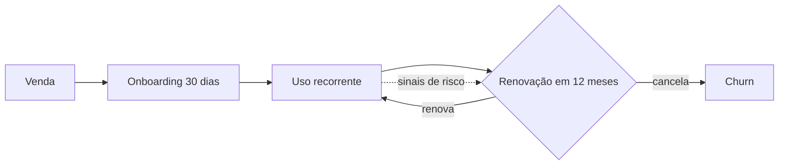

# 02 · O negócio: Frota Leve

> Todo o conteúdo abaixo é fictício e foi criado para o estudo.

## Produto
SaaS de gestão de frotas para pequenas transportadoras, com cinco módulos: **rotas**, **abastecimento**, **manutenção**, **motoristas** e **relatórios**. O cliente típico é um dono de transportadora com 3 a 120 veículos e pouca equipe administrativa.

## Carteira
- 120 clientes ativos; 3 CSMs (a líder de CS, Marcela Andrade, também administra o sistema).
- Segmentos: cargas secas, entregas urbanas, frigorificados e fretamento.

## Planos

| Plano | Veículos | Mensalidade (base + por veículo) |
|---|---|---|
| Básico | 3 a 10 | R$ 190 + R$ 12/veículo |
| Profissional | 11 a 40 | R$ 490 + R$ 12/veículo |
| Frota+ | 41 a 120 | R$ 990 + R$ 12/veículo |

MRR total da carteira sintética: **R$ 80.656**.

## Ciclo de contrato
Contratos de 12 meses com renovação ativa (o cliente precisa aceitar a proposta). A renovação é o momento em que o cancelamento de fato acontece, e também a maior oportunidade de expansão ou ajuste de plano.

## Como o CS decide hoje quem contatar
Hoje a decisão é **manual e por memória**: cada CSM tem uma planilha própria e prioriza (1) quem reclamou por último, (2) quem tem renovação nas próximas semanas e (3) o cliente "que ele sente que está sumido". Não há critério comum nem histórico; quando um CSM sai de férias, o contexto some. Isso gera dois problemas que aparecem nas reuniões simuladas: contas silenciosas (que não reclamam, mas pararam de usar) só são notadas na renovação, e contas barulhentas consomem tempo mesmo quando são pequenas.
