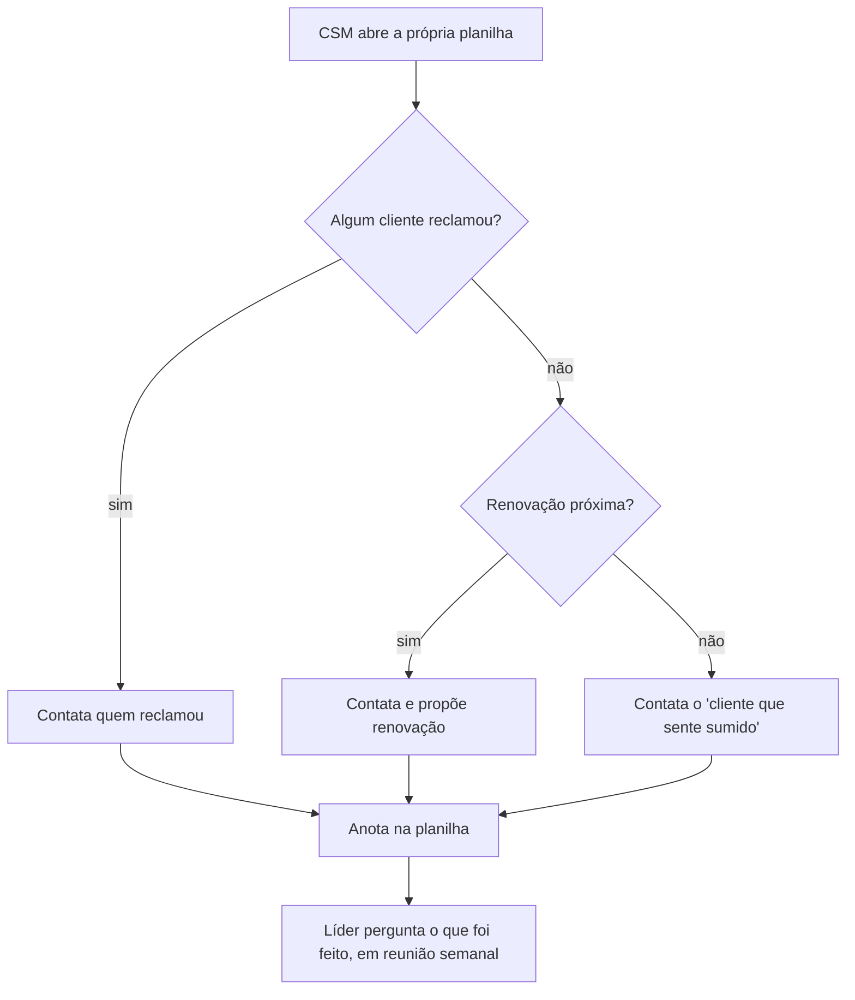

# 05 · Reunião 3, processo AS-IS e definições

## Reunião 3 — Cliente-tipo (dono de transportadora)

> Reunião simulada; pessoas e empresa fictícias.

**Participante (fictício):** Carlos Pereira, dono de uma pequena transportadora com 14 veículos, cliente há dois anos.
**Objetivo:** entender quando um cliente "esfria" e o que faria o CS ser útil, não chato.

**Carlos:** Eu uso a rota e o abastecimento todo dia. A manutenção eu quase não abro; o mecânico faz tudo no caderno dele.

**João:** Se alguém da Frota Leve te ligasse sobre isso, ajudaria?

**Carlos:** Se for para me mostrar como a manutenção economiza dinheiro, sim. Se for para me perguntar se está tudo bem, não: eu deixo de atender.

**Carlos:** O que me faz parar de usar é quando meu motorista principal sai e o novo não sabe mexer. Aí a coisa vai ficando de lado. Ninguém avisa.

**Carlos:** E quando dá problema duas vezes no mesmo lugar, eu já começo a olhar a concorrência.

**Carlos:** Pesquisa de satisfação eu respondo quando lembro; é a cada três meses, não é todo mundo que responde.

**Aprendizados (viram regras):**
- Queda de uso por troca de pessoas é um padrão real → playbook "Queda de uso" com pergunta sobre mudança de equipe.
- Problema repetido pesa mais que problema isolado → regra de "categoria repetida" na dimensão de suporte.
- NPS é trimestral e nem todos respondem → janela de 180 dias e regra de **dado ausente** (a dimensão sai do cálculo em vez de virar nota zero).
- O contato não pode ser genérico → cada playbook tem um motivo específico e não pergunta "está tudo bem?".

## Processo atual (AS-IS)

### Falhas do processo
1. **Contas silenciosas não aparecem.** Quem para de usar sem reclamar só é notado na renovação.
2. **Sem critério comum.** Cada CSM prioriza de um jeito; a líder não consegue comparar.
3. **Sem valor na decisão.** Uma conta de R$ 3.000/mês pode esperar atrás de uma de R$ 250.
4. **Sem histórico.** Quando alguém sai de férias, o contexto some; ninguém sabe se a última ligação resolveu.
5. **Sem explicação.** Quando a líder discorda do CSM, não há dado compartilhado para decidir.

## Definições acordadas

> **Saúde** é o quanto a conta está usando, sendo bem atendida, satisfeita, em dia e longe de um ponto de decisão (renovação). É um **resumo de sinais**, de 0 a 100, em seis dimensões: adoção, engajamento, suporte, satisfação, financeiro e contrato.

> **Risco** é o inverso da saúde: `(100 − score) / 100`. Risco alto não significa "vai cancelar"; significa "tem sinais que merecem contato".

> **Urgência** combina risco, valor e prazo: `urgência = risco × MRR × proximidade da renovação`, onde a proximidade vai de 1 (renovação a 90 dias ou mais) a 2 (vence hoje ou já venceu).

| Cor | Faixa padrão | Significado para o CS |
|---|---|---|
| Verde (Saudável) | score ≥ 75 | Acompanhamento de rotina |
| Amarelo (Atenção) | 50 ≤ score < 75 | Olhar nesta semana |
| Vermelho (Crítica) | score < 50 | Contato prioritário |

As faixas são **configuráveis** pelo administrador (ver ADR-003).
