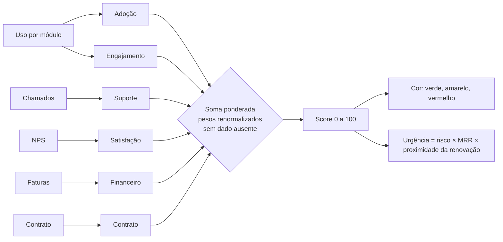

# Metodologia do score de saúde

> **Aviso central.** O score é uma **heurística** construída por mim a partir do problema e das conversas simuladas do discovery. Ele **não é um modelo preditivo validado** e não estima probabilidade de cancelamento. Os pesos e limites precisam ser **calibrados com dados reais** (principalmente com o histórico de quem cancelou). Tudo que foi calculado aqui usa dados **sintéticos**.

## 1. Visão geral

Cada dimensão produz um valor de 0 a 100 (maior = mais saudável). O score é `Σ valor × peso`, onde os pesos são normalizados entre as dimensões que **têm dado**.

## 2. Pesos iniciais e por que os escolhi

| Dimensão | Peso | Por quê |
|---|---:|---|
| Adoção | 25 | É o sinal mais cedo e mais controlável: quem não usa os módulos não percebe valor, e o CS pode agir (treinamento). |
| Engajamento | 20 | Captura **queda** de uso (o cliente "esfriando"), que o cliente-tipo descreveu como o padrão de abandono mais comum. |
| Suporte | 15 | Problemas repetidos corroem a confiança, mas chamado também indica cliente que se importa; por isso peso médio. |
| Satisfação | 15 | NPS é direto, mas trimestral e com baixa resposta; peso médio e tratado como ausente quando velho. |
| Financeiro | 15 | Atraso é sinal forte de dificuldade ou de desengajamento, mas pode ser só burocracia. |
| Contrato | 10 | Não indica insatisfação, apenas **momento de decisão**; peso menor aqui, e a proximidade pesa de novo na urgência. |

Esses pesos são **opiniões fundamentadas**, não estimativas. A análise de sensibilidade abaixo mostra o quanto importa errar neles.

## 3. Indicadores, fórmulas e janelas

Constantes nomeadas em `PARAMS` ([`dimensions.ts`](../../src/lib/score/dimensions.ts)); regras formais em [RN-02 a RN-09](../02-definicao/02-regras-de-negocio.md).

### 3.1 Adoção
`adoção = módulos em uso ÷ 5 × 100`. Módulo em uso: ≥ 4 eventos nos últimos 30 dias. O limite de 4 evita contar um clique acidental como "adoção".
Exemplos (testados): 2 módulos = 40; módulo com 3 eventos = 0; com 4 = 20.

### 3.2 Engajamento
`engajamento = 0,7 × frequência + 0,3 × tendência`
- Frequência = `min(dias ativos nos últimos 30 ÷ 20, 1) × 100` (20 dias úteis é o esperado).
- Tendência = razão entre o volume dos últimos 30 dias e o dos 30 anteriores, limitada a 1; razão 1 vale 100, razão 0,5 vale 0, linear entre elas.
- Sem uso anterior e com uso atual, a razão é tratada como 1 (neutra); sem nenhum uso, 0.

### 3.3 Suporte
`suporte = 100 − penalidades`, sobre chamados dos últimos 60 dias:

| Penalidade | Valor | Teto |
|---|---:|---:|
| Por chamado aberto nos últimos 30 dias | −10 | −40 |
| Por categoria com 2+ chamados | −15 | −30 |
| Por chamado **crítico** ainda aberto | −20 | −40 |
| Algum chamado aberto há mais de 7 dias | −10 | −10 |

Um chamado só conta como "aberto" se não estava resolvido **na data do cálculo** (isso permite reconstruir o histórico).

### 3.4 Satisfação
`satisfação = 0,8 × (nota × 10) + 0,2 × tendência`, com a resposta mais recente dos últimos 180 dias. Tendência = `50 + 10 × (nota atual − nota anterior)`, entre 0 e 100; sem resposta anterior, 50.
Exemplos (testados): nota 9 sem anterior = 82; de 8 para 5 = 50.

### 3.5 Financeiro
Sobre faturas vencidas nos últimos 90 dias: `100 − penalidades`. Fatura paga com mais de 5 dias de atraso: −10. Fatura vencida e não paga: −40 mais 1,5 por dia de atraso (acréscimo máximo −30). Faturas ainda a vencer não penalizam.

### 3.6 Contrato
100 com ≥ 120 dias para a renovação; linear de 100 a 40 entre 120 e 0 dias; **vencido sem renovação = 20**.

## 4. Dados ausentes e confiança
Nem toda conta tem todos os dados. Em vez de transformar "sem dado" em nota 0 (injusto) ou 100 (enganoso), a dimensão **sai do cálculo** e os demais pesos são renormalizados:

| Situação | Dimensões ausentes |
|---|---|
| Conta com menos de 30 dias | adoção e engajamento |
| Sem resposta de NPS em 180 dias | satisfação |
| Sem fatura vencida em 90 dias | financeiro |

Se **menos de 70%** do peso total tem dado, a **confiança é BAIXA** e a visão da conta mostra um aviso. Testes: `engine.test.ts` ("dados ausentes").

## 5. Limites de cor
Padrão: **verde ≥ 75**, **amarelo 50 a 74,9**, **vermelho < 50** (configuráveis). Os limites fixam fronteiras sobre um número contínuo; contas próximas à fronteira mudam de cor com pouca variação, como a sensibilidade mostra.

## 6. Urgência (priorização)
`urgência = (100 − score)/100 × MRR × proximidade`, com proximidade de 1 (renovação a 90+ dias) a 2 (vence hoje ou já venceu). Responde à restrição do time (15 contatos por semana por CSM): o que contatar primeiro.

## 7. Explicação por conta
- **Contribuição** = valor da dimensão × peso usado (pontos que ela soma ao score).
- **O que mudou**: o score é recalculado para 30 dias antes com a mesma configuração e a diferença é decomposta por dimensão. Isso só é possível porque o cálculo é uma função de eventos datados (ver [ADR-001](../04-arquitetura/01-adrs.md)).

## 8. O que o score **não** captura
- **Motivo qualitativo**: um cliente satisfeito que vai fechar a empresa ou ser comprado aparece verde.
- **Concorrência**: ninguém registra que o cliente está testando outro produto.
- **Relacionamento**: o score não sabe que o dono é amigo do CSM, nem que o contato-chave saiu.
- **Gravidade real de chamados**: só conta severidade e repetição, não o impacto financeiro.
- **Uso por veículo**: mede módulos e dias, não se todos os veículos estão cadastrados.
- **Sazonalidade**: uma transportadora de safra tem queda legítima fora da temporada.
- **Valor estratégico** além do MRR (logotipo, indicação).
- **Causalidade**: queda de uso pode ser causa ou consequência de um problema.

## 9. Análise de sensibilidade
Executei 22 cenários sobre as 120 contas sintéticas (`npm run sensitivity`): variar cada peso em ±50%, pesos iguais, remover uma dimensão e deslocar os limites em ±5 pontos. Tabela completa e gerada: [sensibilidade-resultados.md](sensibilidade-resultados.md).

Métricas por cenário: contas que mudam de cor, correlação de Spearman entre o ranking de scores e o da configuração base, quantas das 15 contas mais urgentes continuam entre as 15 mais urgentes e a variação média absoluta do score.

### Leitura dos resultados reais
Base: 69 verdes, 40 amarelas e 11 vermelhas.

1. **A ordem das contas é estável.** Em todos os cenários de peso, Spearman ficou entre **0,936 e 0,998**. Mesmo removendo uma dimensão inteira, a ordem geral se mantém.
2. **A cor é bem mais sensível que a ordem.** Variar um peso em ±50% muda a cor de **0 a 10 contas** (de 120); remover uma dimensão muda **7 a 16**; deslocar os limites em −5/+5 muda **19** e **11**. Os limites são o parâmetro mais sensível, porque há 40 contas amarelas concentradas perto das fronteiras.
3. **Adoção e financeiro são as dimensões que mais alteram a leitura quando saem:** sem adoção, Spearman cai a 0,936 e 14 contas mudam de cor; sem financeiro, 0,963 e 12 contas. Sem engajamento, só 10 das 15 contas mais urgentes se mantêm, o menor valor da tabela.
4. **Satisfação é a que menos pesa**: ±50% muda 1 e 6 contas. Minha hipótese (não verificada) é que isso vem do peso médio (15) somado ao fato de o NPS estar ausente em parte da carteira.
5. **Os "menos 50%" em adoção e engajamento reduzem as críticas** de 11 para 5 e 6: com menos peso nos sinais de uso, parte das contas críticas passa a amarela. Quem decide se uso baixo deve valer 25% do score precisa dessa informação.

### O que eu concluo (e o que não)
- **Concluo:** para **priorizar** (a ordem), o modelo é robusto às escolhas de peso dentro do que testei. Para **classificar por cor**, as fronteiras importam; por isso recomendo tratar as contas a ±5 pontos de uma fronteira como "zona cinzenta" e usar a ordem de urgência, não só a cor.
- **Não concluo:** que o score acerta quem cancela. Os dados foram gerados por arquétipos que eu mesmo desenhei; estabilidade não é validade. Calibrar de verdade exige histórico real de cancelamento.

## 10. Como calibrar com dados reais (próximo passo)
1. Marcar, no histórico, as contas que cancelaram e as que renovaram.
2. Calcular o score de cada uma 90 dias antes da decisão.
3. Comparar as distribuições (separação entre os dois grupos) e ajustar pesos e limites para equilibrar falsos alertas e contas perdidas.
4. Repetir a sensibilidade com o novo ajuste e registrar a mudança de configuração.
