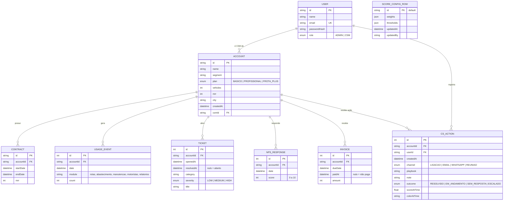

# 02 · Modelo de dados (ER)

Fonte da verdade: [`prisma/schema.prisma`](../../prisma/schema.prisma) e a migração em `prisma/migrations`.

`SCORE_CONFIG_ROW` não tem relação com as demais: é uma configuração global de linha única (ADR-003).

## Índices
Todas as tabelas de eventos têm índice composto por conta e data (`accountId, date`/`openedAt`/`dueDate`), que é o padrão de acesso do cálculo. Há índices em `Account.csmId` e `Account.segment` para os filtros.

## Decisões de modelagem relevantes
- `mrr` é inteiro em reais (sem centavos), suficiente para o estudo; em produção usaria centavos em inteiro.
- `Ticket.resolvedAt` e `Invoice.paidAt` nulos significam "em aberto"; o cálculo compara com a data `asOf` para reconstruir o estado no passado.
- Exclusão de uma conta remove seus eventos em cascata (`onDelete: Cascade`); testado na integração.
