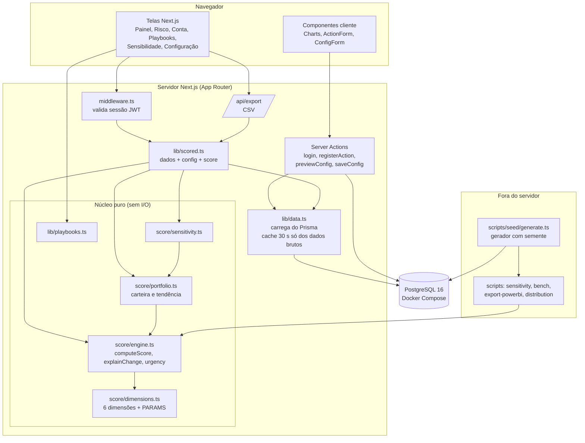

# 03 · Diagrama de componentes

## Por que esta divisão
- O **núcleo puro** (`src/lib/score`) não importa Prisma nem Next. Isso permite testar o cálculo com dados montados à mão (`tests/unit`) e reutilizar exatamente a mesma função no servidor, nos scripts de análise e na exportação para o Power BI.
- `lib/data.ts` é a única porta de entrada de dados do banco para o cálculo; o teste de integração verifica que o score vindo do banco é idêntico ao do gerador em memória.
- **Server Actions** concentram escrita (ação do CS, configuração) com validação Zod; leitura fica em componentes de servidor.
