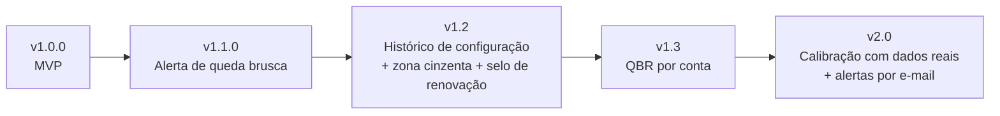

# 02 · Roadmap

Itens ordenados por valor esperado (hipótese) e esforço. Nada abaixo foi medido.

| Versão | Item | Por quê | Dependência |
|---|---|---|---|
| v1.1 ✅ | Alerta de queda brusca de score | Descobrir quedas cedo (pedido do CSM) | Variação de 30 dias (já existia) |
| v1.2 | Histórico versionado de configurações (RN-14) | Rastrear quem mudou pesos e quando (risco R-05) | Nova tabela e tela |
| v1.2 | "Zona cinzenta" a ±5 pontos de uma fronteira de cor e selo de renovação na lista | A sensibilidade mostrou que a cor é frágil perto da fronteira | Nenhuma |
| v1.3 | Relatório de QBR por conta (PDF/HTML) | Reaproveitar a explicação do score em reunião com o cliente | Estabilidade do modelo |
| v1.3 | Pré-agregação de uso por dia (desempenho) | Tendência e sensibilidade lentas | Migração |
| v2.0 | **Calibração com histórico real de cancelamento** | Única forma de validar o score de fato | Dados reais anonimizados |
| v2.0 | Alertas por e-mail | Pedido do CSM, exige serviço de envio | v1.1 validado |
| Aberto | Auditoria de acessibilidade automatizada (axe) | Lacuna declarada em qualidade | — |
| Aberto | Playbook de inadimplência | Hoje a dimensão financeira não dispara playbook | — |

## Fora do roadmap (decisão)
Modelo preditivo de aprendizado de máquina (antes de ter dados reais seria prematuro), multiempresa e CRM real.
