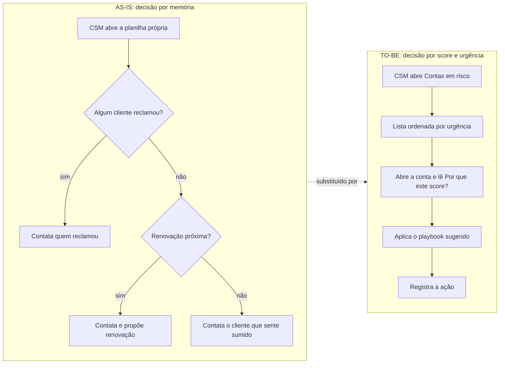

# 01 · Visão e discovery

[Índice](README.md) · Próximo: [Planejamento e Scrum](02-planejamento-e-scrum.md) · Origem: [Episódio 1](../01-discovery/README.md)

## Visão do produto

Para o time de Customer Success de um SaaS de gestão de frotas, que hoje decide de memória quem contatar, o Termômetro é um painel de saúde de clientes que dá a cada conta um score de 0 a 100, mostra de onde ele vem e ordena as contas por urgência. Diferente de um número solto ou de uma previsão de cancelamento, o score é uma heurística explicável: cada ponto é rastreável a uma dimensão e a um dado.

## Problema central e proposta de valor

- **Problema:** a empresa perde clientes pequenos sem aviso. A conta que para de usar sem reclamar só é notada na renovação ou no cancelamento ([o negócio](../01-discovery/02-negocio-frota-leve.md)).
- **Causa operacional:** cada CSM prioriza por planilha própria (quem reclamou por último, renovação próxima, o cliente que "parece sumido"), sem critério comum, sem valor financeiro na decisão e sem histórico ([processo AS-IS](../01-discovery/05-processo-as-is-e-definicoes.md)).
- **Proposta de valor:** uma ordem de contato única, com explicação por conta, que considera risco, valor (MRR) e proximidade da renovação, e que entrega o próximo passo (playbook) e o registro da ação.

## Partes interessadas e personas

| Papel | Interesse | Registro |
|---|---|---|
| Líder de CS (Admin do sistema) | Visão da carteira, priorização, controle da régua do score | [Reunião 1](../01-discovery/03-reuniao-lider-de-cs.md) |
| CSM | Contexto por conta, pouco preenchimento manual, roteiro de contato | [Reunião 2](../01-discovery/04-reuniao-csm.md) |
| Cliente final (dono de transportadora) | Contato útil, não genérico; não ser incomodado sem motivo | [Reunião 3](../01-discovery/05-processo-as-is-e-definicoes.md) |
| Diretoria | Tamanho do problema em reais, sem jargão estatístico | Citada nas reuniões 1 e de validação |
| Equipe de produto e desenvolvimento | Entregar o escopo em 3 sprints com qualidade verificável | [Planejamento](02-planejamento-e-scrum.md) |

## Perguntas de discovery

As perguntas que moldaram o escopo, por reunião:

| Reunião | Pergunta | O que mudou no escopo |
|---|---|---|
| Líder de CS | Como o número 41 seria usado? E se o CSM disser que está errado? | O número precisa de explicação ("Por que este score?") |
| Líder de CS | "Aponte quem vai cancelar" é uma previsão: o que os dados disponíveis permitem prometer? | Pedido de "% de chance de cancelar" refinado e depois recusado ([validação](../04-arquitetura/04-wireframes-e-validacao.md)) |
| Líder de CS | Qual é a capacidade de contato de cada CSM? | Cerca de 15 por semana: lista priorizada por urgência; CRM fora do escopo |
| CSM | Como seria abrir o porquê só ao clicar? | Número em destaque, motivo em uma linha na lista, detalhe na conta |
| CSM | Qual seria o único registro manual aceitável? | Único registro manual: a ação do CS |
| Cliente final | O que faria o contato ser útil e não chato? | Playbooks com motivo específico; não perguntar "está tudo bem?" |

## Escopo e fora de escopo

| Dentro (v1.0.0) | Fora (decisão registrada) |
|---|---|
| Score de 0 a 100 em seis dimensões e cor | Modelo preditivo de aprendizado de máquina |
| Explicação por conta e comparação com 30 dias antes | "% de chance de cancelar" |
| Urgência, lista de risco e painel executivo | Integração com CRM |
| Playbooks (5) e registro de ação | Multiempresa |
| Configuração de pesos com simulação | Alertas por e-mail |
| Sensibilidade, exportação CSV e dados para Power BI | Relatório Power BI montado |

O fora de escopo vem do [MoSCoW](../02-definicao/03-historias-e-moscow.md). O alerta de queda brusca entrou depois, como v1.1.0.

## Restrições, premissas e dependências

| Tipo | Item |
|---|---|
| Negócio | Time de CS com 3 pessoas; cerca de 15 contatos por semana por CSM; sem CRM integrado |
| Dados | Não há dado real nem histórico de cancelamentos; os dados são sintéticos, de gerador com semente fixa ([ADR-005](../04-arquitetura/01-adrs.md)) |
| Técnica | Cálculo do score como função pura, testável sem banco (RNF-05) |
| Premissa | O score resume sinais; risco alto significa "tem sinais que merecem contato", não "vai cancelar" |
| Dependência | Um export real e anonimizado seria necessário para calibrar pesos e limites |

## Riscos iniciais

Os nove riscos do projeto estão em [riscos](../02-definicao/05-riscos.md). Os três que mais orientaram decisões foram o excesso de confiança no número (R-03), a circularidade dos dados sintéticos (R-04) e a mudança de pesos sem registro (R-05).

## Critérios de sucesso e indicadores

| Critério | Como seria verificado | Situação |
|---|---|---|
| O CSM entende o porquê de cada score | Tabela de explicação por conta; aceitação de HU-04 | Aceito na [reunião de aceitação](../05-qualidade/02-reuniao-de-aceitacao.md) (simulada) |
| Ordem de contato estável a mudanças de peso | Spearman na [sensibilidade](../03-metodologia-do-score/sensibilidade-resultados.md) | Observado em dado sintético: 0,936 a 0,998 nos 19 cenários de peso |
| Menos tempo para decidir a lista da semana (H-01) | Medição com uso real | Hipótese, não medida |
| Menos cancelamentos entre contas amarelas contatadas (H-04) | Histórico real de cancelamento | Hipótese, não testável sem dado real |

Os indicadores de negócio (tempo de decisão, cancelamentos evitados, adoção) dependem de operação real e não têm valor medido neste projeto.
