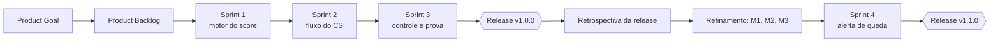

# 02 · Planejamento e Scrum

[Índice](README.md) · Anterior: [Visão e discovery](01-visao-e-discovery.md) · Próximo: [Requisitos e rastreabilidade](03-requisitos-e-rastreabilidade.md) · Origem: [backlog em 3 sprints](../02-definicao/04-backlog-sprints.md)

Esta página é um artefato de planejamento do estudo de caso. A estrutura de Scrum foi montada sobre o escopo e as entregas que o repositório comprova; não há story points, velocity ou burndown medidos, e nenhum número desse tipo é apresentado.

## Product Goal

Dar ao time de CS uma ordem de contato explicável, baseada em sinais de uso, suporte, satisfação, financeiro e contrato, sem prometer previsão de cancelamento.

## Product Backlog priorizado

A prioridade segue o [MoSCoW](../02-definicao/03-historias-e-moscow.md) e a ordem de dependência técnica: sem o motor do score não há painel, e sem o painel não há playbook.

| Ordem | Item | Histórias | Classe | Por que nesta posição |
|---|---|---|---|---|
| 1 | Dados sintéticos reproduzíveis e modelo de dados | HU-11 | Must | Todo o resto depende de dados e de uma data de referência fixa |
| 2 | Motor do score com seis dimensões | HU-04 (RF-03) | Must | É o núcleo; precisa ser função pura e testada |
| 3 | Login, painel, lista por urgência, visão da conta | HU-01, HU-02, HU-03, HU-04 | Must | Fluxo principal do CSM |
| 4 | Playbooks e registro de ação | HU-05, HU-06 | Must | Transforma o score em ação |
| 5 | Pesos configuráveis com simulação | HU-07 | Must e Should | Reduz o risco R-05 |
| 6 | Sensibilidade e exportação CSV | HU-08, HU-09 | Should e Must | Prova de robustez e saída de dados |
| 7 | Layout para celular | HU-10 | Should | Uso fora da mesa |
| 8 | Alerta de queda brusca | HU-12 | Could | Veio da retrospectiva; v1.1.0 |

## Release plan

| Release | Conteúdo | Sprints | Tag no Git |
|---|---|---|---|
| R1 | MVP: score, painel, playbooks, ação, pesos, sensibilidade, CSV, dados para Power BI | 1 a 3 | `v1.0.0` |
| R2 | Alerta de queda brusca | 4 | `v1.1.0` |

## Plano de sprints

Calendário do cenário (planejamento), de segunda a sexta. As datas não coincidem com as dos commits; ver o [índice](README.md#linha-do-tempo).

| Sprint | Período | Objetivo | Página |
|---|---|---|---|
| 1 | 21/09 a 25/09/2026 | Ter um motor do score testado e um banco populado | [Sprint 1](sprints/sprint-1.md) |
| 2 | 28/09 a 02/10/2026 | Percorrer o fluxo painel → conta em risco → porquê → ação | [Sprint 2](sprints/sprint-2.md) |
| 3 | 05/10 a 09/10/2026 | Dar controle e prova: pesos, sensibilidade, CSV, testes ponta a ponta | [Sprint 3](sprints/sprint-3.md) |
| 4 | 19/10 a 23/10/2026 | Avisar quedas bruscas dentro do painel | [Sprint 4](sprints/sprint-4.md) |

## Cerimônias

| Cerimônia | Frequência no cenário | Participantes por papel | Resultado registrado |
|---|---|---|---|
| Sprint Planning | Primeiro dia de cada sprint | Equipe de produto e desenvolvimento; líder de CS como dona do produto no cenário | Sprint Goal e itens escolhidos, na página de cada sprint |
| Refinamento | Meio de cada sprint | Equipe de produto e desenvolvimento | Critérios de aceite em formato Dado/Quando/Então ([histórias](../02-definicao/03-historias-e-moscow.md)) |
| Sprint Review | Último dia de cada sprint | Equipe, líder de CS, CSM | [Revisões de sprint](../05-qualidade/sprint-1-review.md) e [aceitação](../05-qualidade/02-reuniao-de-aceitacao.md) |
| Retrospectiva | Fim de cada sprint; da release em 19/10 | Equipe e CSM | "O que descobri" nas revisões; [retrospectiva da v1.0.0](../06-pos-lancamento/01-reuniao-de-retrospectiva.md) |

As reuniões de validação, aceitação e retrospectiva da release são [registros simulados](reunioes/README.md).

## Definition of Ready

Um item entra na sprint quando:

1. Tem requisito (RF ou RNF) com origem registrada.
2. Tem critério de aceite em Dado/Quando/Então.
3. As regras de negócio que ele usa estão numeradas (RN).
4. Não depende de dado real, de CRM ou de serviço externo.
5. Cabe na sprint junto com seus testes.

## Definition of Done

Um item termina quando:

1. O comportamento atende aos critérios de aceite.
2. Há teste automatizado para as regras novas, e os testes anteriores continuam passando.
3. `lint` e `typecheck` passam sem erro.
4. A documentação afetada (regras, metodologia, rastreabilidade) está atualizada.
5. O commit cita o ID do requisito (`feat(RF-03): ...`).
6. Nenhum segredo entra no repositório.

## Riscos, impedimentos e dependências

| Tipo | Item | Tratamento |
|---|---|---|
| Risco | Distribuição sintética sem contas vermelhas na primeira geração | Arquétipos recalibrados; registrado em [dados sintéticos](../00-sobre-este-caso/dados-sinteticos.md) |
| Risco | Desempenho do cálculo em tempo real | Medido ([desempenho](../04-arquitetura/05-desempenho.md)); ADR-001 define quando migrar |
| Impedimento | Porta de rede ocupada e seletor ambíguo nos testes E2E | [Plano de qualidade](../05-qualidade/01-plano-e-resultados.md), problemas 2 e 3 |
| Dependência | Calibração real depende de dados que não existem neste projeto | Roadmap, v2.0 |

## Mudanças e repriorização

O backlog muda por evidência, não por pedido isolado:

- Pedido que contradiz o princípio do produto é recusado com alternativa (o "% de chance de cancelar").
- Pedido que exige serviço novo é adiado para o roadmap (alertas por e-mail).
- Item da retrospectiva sobe de prioridade quando usa dado que já existe e cabe em uma sprint (M1 virou v1.1.0).

O registro dos pedidos está em [reuniões e solicitações](reunioes/README.md#solicitações-de-mudança).

## Indicadores de fluxo

Não há dados de fluxo (lead time, vazão) observados neste projeto. O que existe de medida de entrega está nas revisões de sprint: contagem de testes ao fim de cada etapa (71 unitários na Sprint 1, 5 de integração na Sprint 2, 13 E2E e 13 prints na Sprint 3, 76 unitários, 14 E2E e 14 prints na v1.1.0).
