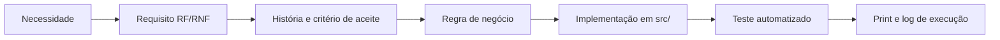

# 03 · Requisitos e rastreabilidade

[Índice](README.md) · Anterior: [Planejamento e Scrum](02-planejamento-e-scrum.md) · Próximo: [Arquitetura e ADRs](04-arquitetura-e-adrs.md) · Origem: [Episódio 2](../02-definicao/README.md)

Esta página acrescenta a camada de necessidade e os papéis ao que já está nos documentos de definição. Requisitos, regras e histórias não são repetidos: ficam em [requisitos](../02-definicao/01-requisitos.md) (14 RF, 7 RNF, 4 hipóteses), [regras de negócio](../02-definicao/02-regras-de-negocio.md) (17 RN) e [histórias com critérios de aceite](../02-definicao/03-historias-e-moscow.md) (12 HU).

## Da necessidade ao requisito

| Necessidade | Origem | Requisitos | Regras | Histórias |
|---|---|---|---|---|
| N-01 · Saber quem contatar primeiro, dentro de cerca de 15 contatos por semana | Reunião 1 | RF-05 | RN-11 | HU-03 |
| N-02 · Ter um número único e também o contexto | Reuniões 1 e 2 | RF-03, RF-04, RF-06 | RN-01 a RN-10, RN-13 | HU-04 |
| N-03 · Receber um roteiro do que fazer | Reunião 2 | RF-07 | RN-12 | HU-05 |
| N-04 · Digitar o mínimo possível | Reunião 2 | RF-08 | RN-15 | HU-06 |
| N-05 · Ajustar a régua sem risco | Reunião 1; validação | RF-09, RF-10 | RN-14 | HU-07 |
| N-06 · Ver o tamanho do problema em reais | Reunião 1; validação | RF-02 | RN-10 | HU-02 |
| N-07 · Descobrir quedas cedo | Retrospectiva | RF-14 | RN-17 | HU-12 |
| N-08 · Levar os dados para análise externa | Reunião 1; metodologia | RF-11, RF-12 | — | HU-08, HU-09 |
| N-09 · Não receber uma previsão sem base | Reunião 1; validação | Won't: "% de chance de cancelar" | — | — |

N-09 é uma necessidade atendida por recusa: o pedido de percentual foi substituído por cor, score, motivo principal e urgência em reais (ver [reuniões e solicitações](reunioes/README.md)).

## Rastreabilidade completa

A tabela do requisito ao código, ao teste e ao print está em [rastreabilidade](../02-definicao/06-rastreabilidade.md), com 15 linhas. Exemplo de uma cadeia inteira:

| Elo | Registro |
|---|---|
| Necessidade | N-07 · descobrir quedas cedo |
| Requisito | RF-14 |
| História | HU-12: conta com queda de 15 pontos ou mais em 30 dias aparece na página de alertas e como indicador no painel |
| Regra | RN-17 |
| Implementação | `src/lib/score/alerts.ts` (`detectSuddenDrops`), `alertas/page.tsx`, banner em `page.tsx` |
| Teste | `tests/unit/alerts.test.ts` (5 testes) e um E2E de alertas |
| Evidência | [print 13](../screenshots/13-alertas-queda-brusca.png) e os logs em [qualidade](../05-qualidade/README.md) |

## Partes interessadas e RACI

R = executa, A = responde pela decisão, C = consultado, I = informado.

| Atividade | Líder de CS | CSM | Cliente final (persona) | Equipe de produto e desenvolvimento |
|---|---|---|---|---|
| Definir o problema e o escopo | A | C | C | R |
| Definir regras e pesos do score | A | C | I | R |
| Validar wireframes | A | C | I | R |
| Implementar e testar | I | I | — | A e R |
| Aceitar a release | A | C | — | R |
| Escolher melhorias da retrospectiva | A | C | — | R |

## Casos de uso principais

| Caso de uso | Ator | Fluxo principal |
|---|---|---|
| UC-01 · Priorizar a semana | CSM | Painel → Contas em risco → lista por urgência |
| UC-02 · Entender uma conta | CSM | Abrir conta → "Por que este score?" → "O que mudou" |
| UC-03 · Agir | CSM | Ler playbook → copiar mensagem → registrar ação |
| UC-04 · Ajustar a régua | Admin | Configuração → Simular → Salvar e aplicar |
| UC-05 · Conferir robustez | Admin | Sensibilidade → comparar cenários |
| UC-06 · Exportar | CSM ou Admin | Painel → CSV de carteira, histórico ou ações |
| UC-07 · Ver quedas | CSM | Banner do painel → Alertas |

O fluxo de negócio AS-IS e TO-BE está em [visão e discovery](01-visao-e-discovery.md#problema-central-e-proposta-de-valor), e a sequência técnica do fluxo principal em [arquitetura](04-arquitetura-e-adrs.md#sequência-do-fluxo-principal).

## Critérios de aceite do produto

O MVP foi aceito para o escopo do estudo na [reunião de aceitação](../05-qualidade/02-reuniao-de-aceitacao.md) (simulada): HU-01 a HU-11 aceitas, com três itens para a evolução (histórico versionado da configuração, selo de renovação, alerta de queda brusca, este último entregue na v1.1.0). Critérios por fluxo:

| Fluxo | Critério | Verificação |
|---|---|---|
| Acesso | Rota interna sem sessão redireciona ao login; API sem sessão responde 401; senha errada não entra | E2E "acesso" (3 testes) |
| Priorização | Lista em ordem decrescente de urgência; filtro de críticas reduz a lista | Unitário "urgência"; E2E de filtro |
| Explicação | Cada dimensão mostra valor, peso usado, contribuição e mudança | E2E do fluxo principal |
| Ação | Nota curta é recusada; ação válida grava score e cor do momento | E2E; integração "ação do CS" |
| Configuração | Simular não grava; limites invertidos são recusados; CSM não salva | E2E "configuração de pesos" (3 testes) |
| Mobile | Painel sem rolagem horizontal em 390 px | E2E "mobile" |

## Registro de mudanças

Pedidos aceitos, adiados, parciais e recusados estão na [tabela de solicitações](reunioes/README.md#solicitações-de-mudança).
