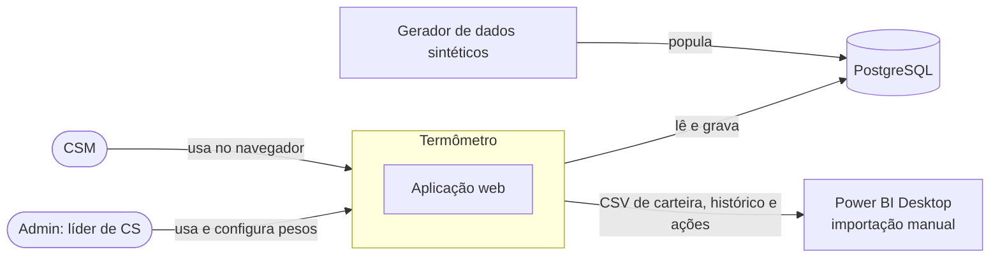
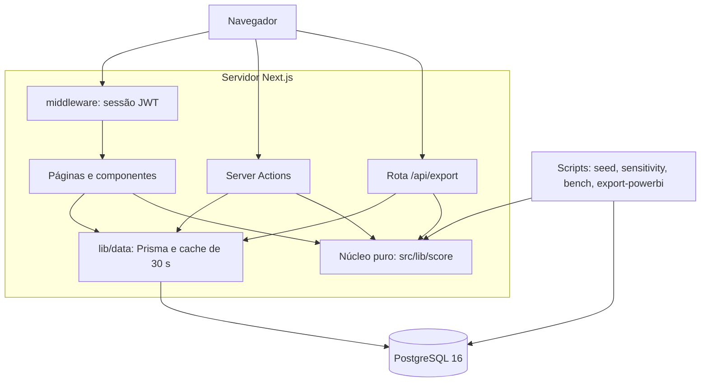
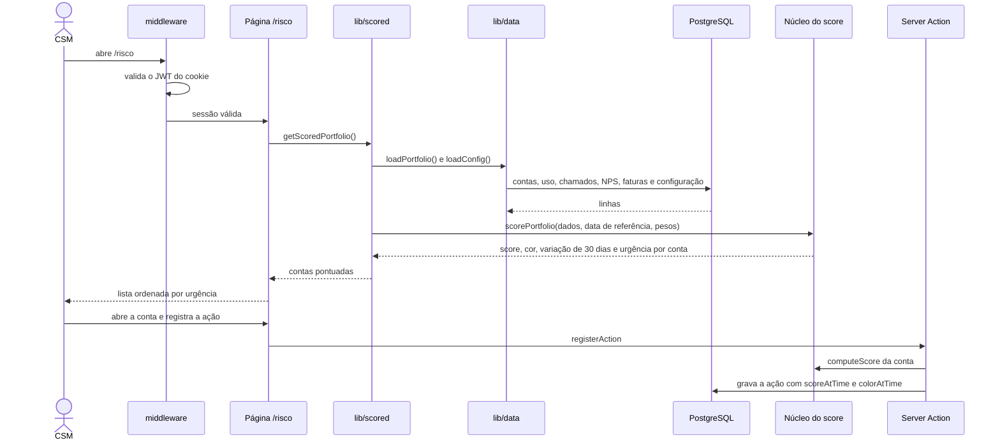
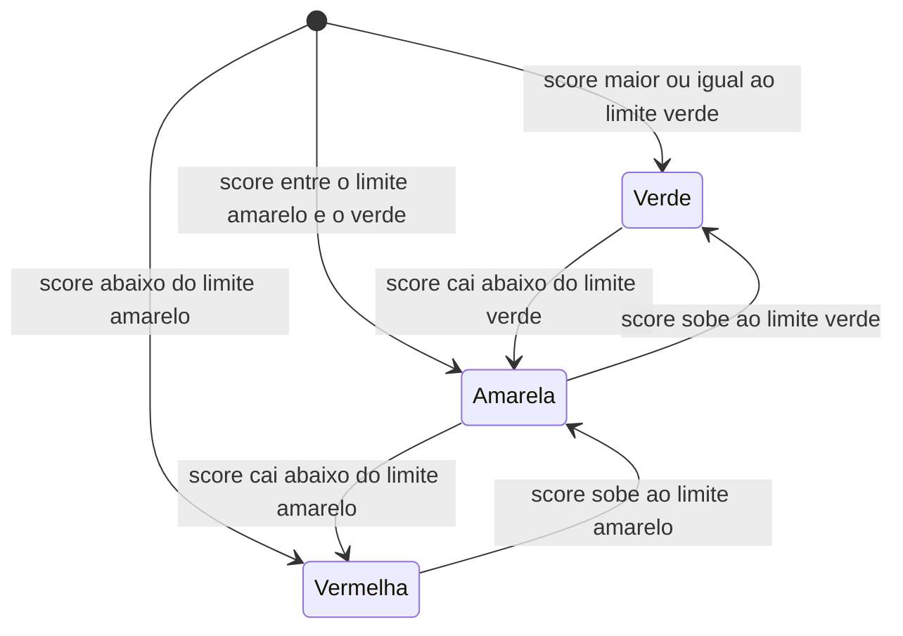

# 04 · Arquitetura e ADRs

[Índice](README.md) · Anterior: [Requisitos e rastreabilidade](03-requisitos-e-rastreabilidade.md) · Próximo: [Modelo de dados](05-modelo-de-dados.md) · Origem: [Episódio 4](../04-arquitetura/README.md)

Os diagramas abaixo descrevem o sistema como está no código da `v1.1.0`. Os detalhes de componentes e decisões estão em [componentes](../04-arquitetura/03-componentes.md) e [ADRs](../04-arquitetura/01-adrs.md).

## Contexto

Não há integração com CRM, e-mail ou serviço externo. O Power BI recebe arquivos, não uma conexão.

## Contêineres

O núcleo `src/lib/score` não importa Prisma nem Next: recebe dados e uma data e devolve números. Isso permite testá-lo com dados montados à mão e reaproveitá-lo nos scripts de sensibilidade, de benchmark e de exportação.

## Sequência do fluxo principal

Priorizar e agir sobre uma conta.

Na conta, `loadPortfolio` mantém os dados brutos em cache por 30 s; configuração e ações são lidas na hora. Sem sessão válida, o middleware redireciona ao login (ou responde 401 na API).

## Estados da cor da conta

A cor é função do score e dos limites configurados; não há estado gravado.

Os limites padrão são 75 e 50 e podem ser mudados pelo Admin. Contas perto de um limite trocam de cor com pouca variação, o que a [sensibilidade](../03-metodologia-do-score/sensibilidade-resultados.md) mostra (19 contas mudam com −5 pontos).

## Fluxo de dados e integrações

| Fluxo | Origem | Destino | Mecanismo |
|---|---|---|---|
| Dados de demonstração | `scripts/seed/generate.ts` | PostgreSQL | `npm run db:seed` (semente 20261015) |
| Leitura para as telas | PostgreSQL | Núcleo do score | Prisma e cache de 30 s dos dados brutos |
| Registro de ação | Formulário | PostgreSQL | Server Action com validação Zod |
| Configuração de pesos | Tela do Admin | `ScoreConfigRow` | Server Action; só Admin salva |
| Exportação | Núcleo do score | CSV | Rota `/api/export` (carteira, histórico, ações) |
| Dados para BI | Gerador e núcleo | `powerbi/data/*.csv` | `npm run export:powerbi`, sem banco |

## ADRs

| ADR | Decisão | Alternativas | Consequência principal |
|---|---|---|---|
| 001 | Cálculo em tempo real, cache de 30 s só dos dados brutos | Lote noturno; híbrido | O custo cresce com a carteira (carteira ≈ 106 ms, tendência ≈ 800 ms, sensibilidade ≈ 2,8 s) |
| 002 | Reconstruir o histórico avaliando a função em datas passadas | Tabela de snapshots | Uma régua só; mais CPU; não registra o que o painel mostrava naquele dia |
| 003 | Configuração em linha única no banco, validada por Zod | Constantes no código; variáveis de ambiente | Efeito imediato sem deploy; sem histórico de mudanças (risco R-05) |
| 004 | PostgreSQL com Prisma; uso agregado por dia e módulo | Evento por clique; JSON | Sem consulta por usuário ou por veículo |
| 005 | Dados sintéticos por arquétipos com semente fixa | Planilha; dataset público | Circularidade: o modelo "acerta" o que foi desenhado |
| 006 | Sessão JWT assinada em cookie `httpOnly` (`jose` e `bcryptjs`) | Biblioteca de autenticação completa | Sem recuperação de senha, MFA ou bloqueio por tentativas |

Cada ADR traz contexto, alternativas, escolha, motivo, trade-off e quando mudaria, em [ADRs](../04-arquitetura/01-adrs.md).

## Requisitos de qualidade

| Atributo | Como o sistema trata | Limite conhecido |
|---|---|---|
| Segurança | Senha com bcrypt, cookie `httpOnly`, validação Zod, middleware em rotas e API | Segurança de demonstração local; sem MFA nem limite de tentativas |
| Desempenho | Cálculo da carteira ≈ 106 ms, tendência ≈ 800 ms ([medição](../04-arquitetura/05-desempenho.md)) | Medido só com 120 contas e sem data registrada; tempo total da página não medido |
| Manutenibilidade | Núcleo puro e tipado; parâmetros nomeados em `PARAMS` | Atualizar código, regras, metodologia e testes juntos ao mexer no score |
| Disponibilidade | Não tratada: execução local | Sem redundância, sem monitoramento |
| Observabilidade | Não implementada | Sem logs estruturados, métricas nem alertas operacionais |
