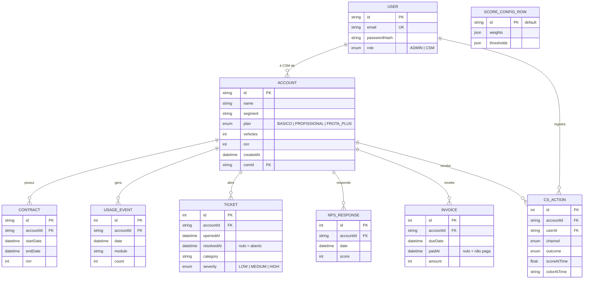
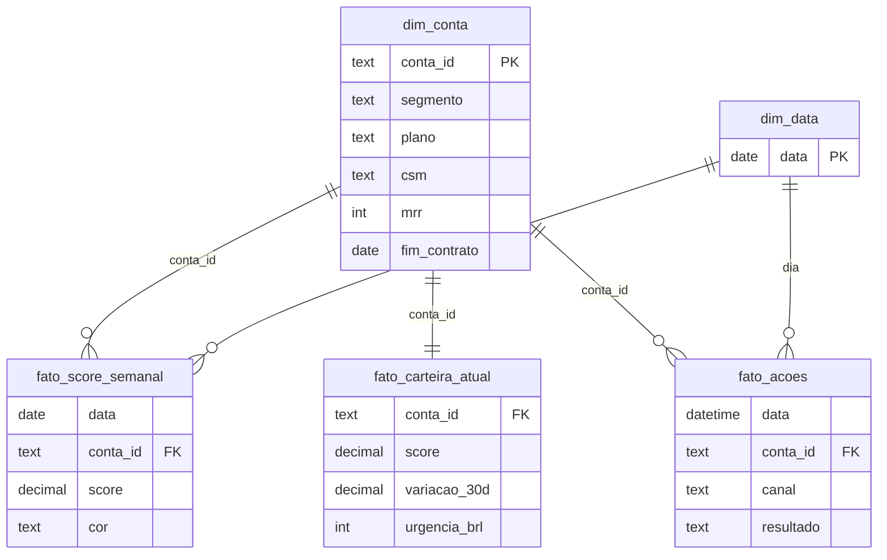

# 05 · Modelo de dados

[Índice](README.md) · Anterior: [Arquitetura e ADRs](04-arquitetura-e-adrs.md) · Próximo: [Desenvolvimento e configuração](06-desenvolvimento-e-configuracao.md) · Origem: [modelo ER](../04-arquitetura/02-modelo-er.md) e `prisma/schema.prisma`

Tudo o que está nesta página corresponde ao `schema.prisma` e à migração `20261023192941_init` da `v1.1.0`. O que é plano futuro aparece só na seção de evolução, marcado como tal.

## Modelo entidade-relacionamento

`SCORE_CONFIG_ROW` não se relaciona com as demais: é uma configuração global de linha única (ADR-003). O diagrama omite alguns campos de texto (`city`, `title`, `note`, `playbook`); o completo está em [modelo ER](../04-arquitetura/02-modelo-er.md).

## Dicionário de dados

| Tabela | Colunas principais | Chaves e restrições | Uso no score |
|---|---|---|---|
| `User` | `id`, `name`, `email`, `passwordHash`, `role` | PK `id`; `email` único; `role` ADMIN ou CSM | Papel define quem salva a configuração |
| `Account` | `id`, `name`, `segment`, `plan`, `vehicles`, `mrr` (inteiro em reais), `city`, `createdAt`, `csmId` | PK `id`; FK `csmId` → `User`; índices em `csmId` e `segment` | `createdAt` define onboarding (30 dias); `mrr` entra na urgência |
| `Contract` | `accountId`, `startDate`, `endDate`, `mrr` | PK `id` (cuid); FK com exclusão em cascata; índice `(accountId, endDate)` | Dimensão contrato e proximidade da renovação |
| `UsageEvent` | `accountId`, `date`, `module`, `count` | PK `id`; FK em cascata; índice `(accountId, date)` | Adoção (módulos com 4 ou mais eventos em 30 dias) e engajamento |
| `Ticket` | `accountId`, `openedAt`, `resolvedAt`, `category`, `severity`, `title` | PK `id`; FK em cascata; índice `(accountId, openedAt)` | Suporte; `resolvedAt` nulo = aberto |
| `NpsResponse` | `accountId`, `date`, `score` (0 a 10) | PK `id`; FK em cascata; índice `(accountId, date)` | Satisfação (janela de 180 dias) |
| `Invoice` | `accountId`, `dueDate`, `paidAt`, `amount` | PK `id`; FK em cascata; índice `(accountId, dueDate)` | Financeiro; `paidAt` nulo = não paga |
| `CsAction` | `accountId`, `userId`, `createdAt`, `channel`, `playbook`, `note`, `outcome`, `scoreAtTime`, `colorAtTime` | PK `id`; FK `accountId` em cascata e `userId`; índice `(accountId, createdAt)` | Registro de ação; grava score e cor do momento (RN-15) |
| `ScoreConfigRow` | `id` ("default"), `weights`, `thresholds`, `updatedAt`, `updatedBy` | PK `id`; JSON validado por Zod ao salvar | Pesos e limites vigentes |

Enumerações: `Role`, `Plan`, `TicketSeverity` (LOW, MEDIUM, HIGH), `ActionChannel` (LIGACAO, EMAIL, WHATSAPP, REUNIAO) e `ActionOutcome` (RESOLVIDO, EM_ANDAMENTO, SEM_RESPOSTA, ESCALADO).

## Normalização e justificativas

- O modelo segue a terceira forma normal para os dados cadastrais: conta, contrato e usuário em tabelas próprias, e cada evento ligado à conta por chave estrangeira.
- O contrato tem tabela própria para que renovações futuras virem novas linhas, sem sobrescrever datas (ADR-004). A conta lê a linha de maior `endDate`.
- O uso é gravado já agregado por conta, dia e módulo, e não por clique. É uma desnormalização deliberada: o score só precisa de dias ativos e volume por módulo. O custo é não responder perguntas por usuário ou por veículo.
- `CsAction.scoreAtTime` e `colorAtTime` guardam o que o score mostrava no momento da ação, para auditoria; nas 64 ações do seed esses campos ficam nulos.

## Integridade, índices e migrations

- A migração `20261023192941_init` cria as 9 tabelas, os 5 enums e 9 índices (8 compostos ou simples mais o único de `User.email`). É a única migração existente.
- Excluir uma conta remove seus contratos, eventos, chamados, NPS, faturas e ações em cascata; o comportamento é coberto no teste de integração.
- Os índices compostos por conta e data correspondem ao padrão de acesso do cálculo, que lê tudo de uma conta em uma janela de datas.
- Valores monetários são inteiros em reais, suficiente para o estudo; um sistema de cobrança usaria centavos.

## Estratégia de seeds e dados de demonstração

O comando `npm run db:seed` (`scripts/seed/index.ts`) apaga todas as tabelas e recria o conjunto a partir de `generateDataset(seed, referenceDate)`, uma função pura com gerador pseudoaleatório mulberry32. Com a semente 20261015 e a data de referência 2026-10-15, o resultado é sempre o mesmo, o que sustenta o RNF-06 e os números dos documentos.

| Item gerado | Quantidade (semente padrão) |
|---|---|
| Contas | 120, com 3 CSMs em rodízio |
| Registros de uso diário por módulo | 41.578 |
| Chamados | 504 |
| Respostas de NPS | 184 |
| Faturas | 805 |
| Ações do CS | 64 |

Cada conta recebe um de oito arquétipos (saudável, em queda, baixa adoção, muitos chamados, insatisfeito, mau pagador, conta nova, churn iminente). Os arquétipos são hipóteses de quem desenhou o estudo, portanto "o score separa os arquétipos" não é validação ([dados sintéticos](../00-sobre-este-caso/dados-sinteticos.md)). O seed é repetível porque recria tudo do zero; ele não roda dentro de uma transação única.

## Consistência, idempotência e acesso

- **Configuração:** a leitura devolve a configuração padrão quando a linha não existe ou não passa na validação; salvar usa `upsert` e só o Admin pode salvar.
- **Registro de ação:** o servidor recalcula o score da conta na hora de gravar, em vez de confiar em valor enviado pelo navegador.
- **Cache:** os dados brutos ficam 30 s em memória; configuração e ações são sempre lidas do banco.
- **Privacidade:** não há dado pessoal real. A senha é guardada como hash bcrypt e o único usuário com acesso total é o Admin.
- **Retenção e auditoria:** não há política de retenção nem trilha de mudanças de configuração, só `updatedAt` e `updatedBy` da última (risco R-05, roadmap v1.2).
- **Métricas mensais:** não existe tabela de métricas mensais. O histórico semanal é reconstruído avaliando a função do score em datas passadas (ADR-002).

## Esquema estrela para o Power BI

O export (`npm run export:powerbi`) gera quatro CSVs em `powerbi/data/`, sem usar o banco. A tabela de datas é criada no próprio Power BI.

| Arquivo | Linhas | Conteúdo |
|---|---:|---|
| `dim_conta.csv` | 120 | Cadastro da conta |
| `fato_score_semanal.csv` | 1.355 | Score, cor e seis dimensões por conta e semana |
| `fato_carteira_atual.csv` | 120 | Score atual, variação em 30 dias, dias para renovar e urgência |
| `fato_acoes.csv` | 64 | Ações do CS |

### O valor 1.355

O arquivo `fato_score_semanal.csv` seria de 1.440 linhas se toda conta existisse em todas as 12 semanas (12 × 120). O script `scripts/export-powerbi.ts` pula o par conta-semana quando `d.account.createdAt > date`, isto é, quando a conta ainda não existia naquela data. Esses pares ausentes somam 85, e 1.440 − 85 = 1.355. Contagem de linhas por semana no arquivo: 104 na primeira semana (30/07) e 120 nas duas últimas, o que confere com o crescimento da carteira. As medidas DAX e o passo a passo estão em [powerbi/README.md](../../powerbi/README.md); o relatório em si não está montado.

## Evolução prevista dos dados

Itens do [roadmap](../06-pos-lancamento/02-roadmap.md), ainda não implementados: tabela de histórico versionado de configuração (v1.2) e pré-agregação diária de uso por conta e módulo (v1.3).
