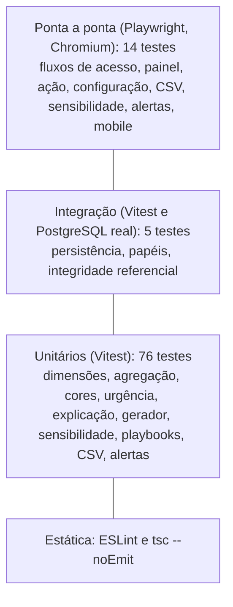

# 07 · Testes e qualidade

[Índice](README.md) · Anterior: [Desenvolvimento e configuração](06-desenvolvimento-e-configuracao.md) · Próximo: [Implantação e operação](08-implantacao-e-operacao.md) · Origem: [Episódio 5](../05-qualidade/README.md)

## Estratégia e pirâmide de testes

A maior parte da verificação está no núcleo puro do score, onde cada regra pode ser testada com dados montados à mão. Poucos testes de integração conferem a persistência, e poucos testes ponta a ponta cobrem os fluxos de uso.

Não há testes de contrato, de segurança automatizados, de desempenho nem de acessibilidade (ver [lacunas](#lacunas-e-casos-propostos)).

## Casos por tipo

Os testes abaixo existem no repositório e fazem parte das contagens registradas.

| Tipo | Exemplos | Arquivo |
|---|---|---|
| Positivo | 5 módulos com 4 ou mais eventos dão adoção 100; conta saudável fica alta e verde; uma resposta de NPS 9 dá 82 | `dimensions.test.ts`, `engine.test.ts` |
| Negativo | Peso negativo, soma zero e limites invertidos são recusados; senha errada não entra; nota curta é recusada; CSM não salva configuração | `engine.test.ts`, E2E |
| Limite | 3 eventos não contam como módulo em uso e 4 contam; −15 pontos dispara o alerta e −14,9 não; exatamente 70% do peso ainda é confiança alta; atraso de 5 dias é tolerado e 6 penaliza | `dimensions.test.ts`, `engine.test.ts`, `alerts.test.ts` |
| Erro e dado ausente | Sem NPS ou sem fatura a dimensão sai e os pesos se renormalizam; soma de pesos zero não quebra; score nunca sai de 0 a 100 | `engine.test.ts` |
| Reprodutibilidade | Mesma semente gera os mesmos dados; nenhum evento depois da data de referência | `system.test.ts` |
| Integração | O score calculado do banco é idêntico ao do gerador; excluir a conta remove seus dados | `tests/integration` |
| Aceite | Cada história HU-01 a HU-12 tem critérios Dado/Quando/Então, verificados pelos fluxos E2E e unitários mapeados em [rastreabilidade](../02-definicao/06-rastreabilidade.md) | `tests/e2e/flows.spec.ts` |

## Regressão

- Entre a `v1.0.0` e a `v1.1.0` a suíte passou de 71 para 76 testes unitários e de 13 para 14 E2E, com todos os testes anteriores mantidos e passando.
- O teste que compara o score do banco com o do gerador funciona como regressão de persistência: qualquer mudança de schema ou de adaptador que altere o resultado o derruba.
- Após cada mudança no score, a sensibilidade é regenerada com `npm run sensitivity`, como orienta o [CONTRIBUTING.md](../../CONTRIBUTING.md).

## Execução registrada

Resultados efetivamente obtidos, em 2026-10-24. O código de `src`, `scripts`, `tests` e `prisma` é o da tag `v1.1.0`; a única mudança de código é a leitura da porta em `playwright.config.ts`.

| Comando | Resultado | Commit | Log |
|---|---|---|---|
| `npm run lint` | saída 0 | `d45b65c` | [log](../05-qualidade/execucao-lint-d45b65c.txt) |
| `npm run typecheck` | saída 0 | `d45b65c` | [log](../05-qualidade/execucao-typecheck-d45b65c.txt) |
| `npm test` | 4 arquivos, 76 testes passando | `d45b65c` | [log](../05-qualidade/execucao-test-d45b65c.txt) |
| `npm run test:integration` | 1 arquivo, 5 testes passando | `d45b65c` | [log](../05-qualidade/execucao-test-integration-d45b65c.txt) |
| `npm run test:e2e` | 14 testes passando em 3,7 min (porta 3101) | `4598c4c` | [log](../05-qualidade/execucao-e2e-4598c4c.txt) |

O primeiro E2E, no commit `ebbe1dd`, não executou por porta ocupada; o [log da falha](../05-qualidade/execucao-test-e2e-ebbe1dd.txt) foi mantido. Os registros anteriores (v1.0.0 e v1.1.0) estão em [plano e resultados](../05-qualidade/01-plano-e-resultados.md).

## Defeitos, causa raiz e correção

| # | Defeito | Causa raiz | Correção |
|---|---|---|---|
| 1 | Chamados do gerador com data posterior à de referência | A referência é 12h e chamados abertos à tarde ficavam no futuro | Descartar chamados abertos depois do instante de referência; o teste "nenhum evento depois da data de referência" permanece |
| 2 | Todos os E2E falhando | Outro servidor ocupava a porta 3000 e o Playwright o reaproveitava | Termômetro passou para a porta 3100 |
| 3 | Três E2E falhando por seletor | `getByRole("alert")` encontrava também o anunciador de rotas do Next | Seletor específico `p[role=alert]` |
| 4 | Rosca cortada no primeiro print | Animação do gráfico em andamento na captura | Animações desligadas |
| 5 | Primeira distribuição sem contas vermelhas | Arquétipos e limites mal calibrados | Calibragem registrada |
| 6 | E2E sem subir o servidor com a 3100 ocupada (2026-10-24) | Porta fixa em `playwright.config.ts` | Porta lida de `PORT`, padrão 3100 (commit `4598c4c`) |

## Cobertura e limitações

- Cobertura percentual de linhas não foi medida; os números são contagem de testes.
- Os E2E rodam só em Chromium e só com dados sintéticos.
- Não há teste de carga: o desempenho foi medido só com 120 contas, em [desempenho](../04-arquitetura/05-desempenho.md).
- Acessibilidade: há rótulos, `aria-label` e texto além da cor, sem auditoria automatizada.
- Testes em dado sintético medem consistência e regras, não acerto de cancelamento.

## Lacunas e casos propostos

Casos que melhorariam a estratégia. Não foram escritos nem executados, e nenhum resultado é afirmado.

| Caso proposto | Objetivo |
|---|---|
| Auditoria axe ou Lighthouse nas telas de painel, lista, conta e configuração | Medir acessibilidade e fechar a lacuna declarada |
| Teste de carga com carteira de 1.000 contas ou mais | Verificar o ponto de troca de cálculo em tempo real para snapshots (ADR-001) |
| Conferência automática entre `fato_carteira_atual.csv` e a exportação do sistema | Garantir que os dois caminhos de dados para BI concordam |
| Teste de bloqueio por tentativas de login | Hoje não existe; serviria de regressão quando o recurso for criado |
| Workflow de CI executando a suíte | Tirar a dependência de execução manual |
