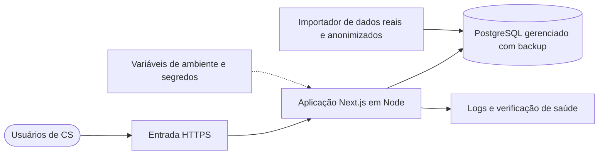

# 08 · Implantação, operação e adoção

[Índice](README.md) · Anterior: [Testes e qualidade](07-testes-e-qualidade.md) · Próximo: [Evolução e roadmap](09-evolucao-e-roadmap.md)

## O que existe e o que é plano

| Aspecto | Existe e está comprovado | Plano do cenário (não executado) |
|---|---|---|
| Execução | Ambiente local: banco em Docker Compose e aplicação Next.js ([CONTRIBUTING.md](../../CONTRIBUTING.md)) | Ambientes de homologação e produção |
| Deploy | Nenhum: não há hospedagem, workflow nem URL de demonstração | Plano de implantação abaixo |
| Dados | Gerador sintético com semente fixa | Importação de um export real e anonimizado |
| Monitoramento | Nenhum | Logs, verificação de saúde e alertas |
| Treinamento | Playbooks e documentação de uso no repositório | Onboarding do time de CS |

Tudo o que está marcado como plano descreve o que seria preciso para operar o produto; nada disso foi implantado nem testado em ambiente real.

## Arquitetura de implantação planejada

Pontos de decisão que a implantação exigiria:

- Trocar a autenticação por um provedor de identidade, com limite de tentativas e MFA (ADR-006 diz quando).
- Trocar o gerador por um importador e recalibrar pesos e limites com histórico de cancelamento (roadmap v2.0).
- Definir `AUTH_SECRET` próprio por ambiente e nunca reutilizar o valor de exemplo.
- Reavaliar o cálculo em tempo real com a carteira real (ADR-001 indica o ponto de troca).

## Ambientes e configuração

| Ambiente | Finalidade | Dados |
|---|---|---|
| Desenvolvimento (existe) | Construção e testes | Sintéticos, semente 20261015 |
| Homologação (plano) | Validação com o time de CS | Amostra anonimizada |
| Produção (plano) | Uso diário | Dados reais anonimizados e protegidos |

A configuração é por variáveis de ambiente (`DATABASE_URL`, `AUTH_SECRET`, `REFERENCE_DATE`). Em produção, `REFERENCE_DATE` deixaria de ser fixa e o "hoje" passaria a ser a data real.

## Plano de implantação e rollout

1. **Pré-condições:** dados reais anonimizados disponíveis; autenticação trocada; backup do banco configurado.
2. **Piloto:** uma pessoa de CS usa o painel por um ciclo de contatos, comparando a ordem de urgência com a própria lista.
3. **Ampliação:** o time inteiro, com a configuração padrão de pesos e o aviso visível de que o score é heurística.
4. **Revisão:** após um período combinado, revisar pesos e limites com o feedback registrado nas ações e a sensibilidade.

Critério para avançar de etapa: a explicação por conta ser entendida pelo CSM e a lista não ser contestada por falso alarme sistemático (risco R-01).

## Plano de rollback

- Aplicação: voltar à tag anterior (`v1.0.0` é restaurável a partir da `v1.1.0`, porque a v1.1.0 não mudou o schema).
- Dados: restaurar o último backup; a migração `init` é a única e não há migração a desfazer.
- Configuração de pesos: voltar ao padrão pela tela ("Voltar ao padrão"), ação que já existe e é coberta por E2E.

## Migração e preparação dos dados

O importador precisaria produzir as mesmas entidades do [modelo de dados](05-modelo-de-dados.md): contas, contratos, uso diário por módulo, chamados, NPS e faturas. A validação seria comparar a contagem por tabela e os totais de MRR com a origem, e rodar o teste de integração de persistência. Esse importador não existe.

## Treinamento e documentação operacional

- **Treinamento:** apresentar a tela "Por que este score?" e os cinco playbooks; reforçar que cor e score resumem sinais, e que a urgência (não a cor) define a ordem de contato.
- **Documentação existente:** [metodologia](../03-metodologia-do-score/README.md), [regras de negócio](../02-definicao/02-regras-de-negocio.md), biblioteca de [playbooks](../screenshots/06-playbooks.png) e [glossário](../GLOSSARIO.md).
- **Documentação a criar:** runbook de operação (backup, restauração, rotação de segredos).

## Monitoramento, suporte e alertas

Não implementados. O mínimo para operar seria: registro de erros do servidor, verificação de saúde da aplicação e do banco, alerta de falha no cálculo e acompanhamento do tempo de resposta do painel contra a meta de 2 s (RNF-01). Suporte: canal do time de CS para dúvidas de uso, com a líder como responsável pelas mudanças de configuração.

## Indicadores de adoção

Nenhum foi medido. Os candidatos, com a hipótese que cada um testaria:

| Indicador | Hipótese relacionada |
|---|---|
| Ações registradas por CSM por semana | R-06: o CSM abandona o painel se exigir digitação (queda no registro é o sinal de alerta) |
| Tempo da líder para montar a lista da semana | H-01 |
| Discordâncias entre líder e CSM sobre o número | H-02 |
| Contas amarelas contatadas antes da renovação e seu desfecho | H-04, testável só com histórico real |

## Riscos operacionais e continuidade

| Risco | Efeito | Tratamento planejado |
|---|---|---|
| Pesos alterados sem registro (R-05) | Leitura da carteira muda sem explicação | Histórico versionado de configuração (roadmap v1.2) |
| Excesso de confiança no número (R-03) | Score tratado como probabilidade | Rótulo "heurística" na interface e na documentação |
| Cálculo lento com carteira maior (R-07) | Painel acima de 2 s | Pré-agregação e snapshots |
| Perda do banco | Perda das ações registradas | Backup e teste de restauração |
| Credencial de demonstração em ambiente real | Acesso indevido | Provedor de identidade e remoção das contas fictícias |
