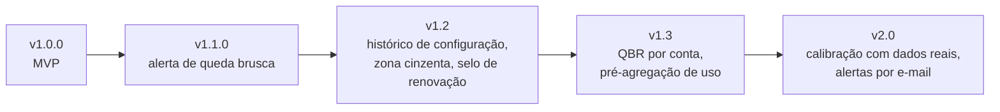

# 09 · Evolução e roadmap

[Índice](README.md) · Anterior: [Implantação e operação](08-implantacao-e-operacao.md) · Próximo: [Regras analíticas do score](10-regras-analiticas-do-score.md) · Origem: [Episódio 6](../06-pos-lancamento/README.md)

## Histórico de versões

| Versão | Data da tag | Conteúdo | Evidência |
|---|---|---|---|
| `v1.0.0` | 2026-10-23 | MVP: modelo de dados, gerador, motor do score, login, painel, lista de risco, conta, playbooks, ação, pesos com simulação, sensibilidade, CSV, testes, 13 prints e dados para Power BI | [CHANGELOG](../../CHANGELOG.md), [release](https://github.com/Joaogabrielmaia/Customer-Health/releases/tag/v1.0.0) |
| `v1.1.0` | 2026-10-23 | Alerta de queda brusca (RF-14): página `/alertas`, banner e 5 testes unitários, 1 E2E e 1 print | [PR da v1.1](../06-pos-lancamento/03-pr-v1.1-alerta-queda-brusca.md), [release](https://github.com/Joaogabrielmaia/Customer-Health/releases/tag/v1.1.0) |
| Não lançado | — | Correção: o Playwright lê a porta de `PORT` | CHANGELOG, seção "Não lançado" |

As datas são as das tags no Git; o [calendário de sprints](02-planejamento-e-scrum.md) é do cenário.

## Solicitações de mudança e impacto

A tabela completa dos pedidos da reunião de validação está em [reuniões e solicitações](reunioes/README.md#solicitações-de-mudança). Os que mudaram a evolução do produto:

| Origem | Mudança | Impacto | Resultado |
|---|---|---|---|
| Validação, pedido 5 | Simular pesos antes de salvar | Nova ação na configuração, sem gravar | Entregue na v1.0.0 (RF-10) |
| Validação, pedido 7 | Alerta de queda de cor por e-mail | Exigiria serviço de e-mail | Adiado; entregue como alerta dentro do painel na v1.1.0 |
| Retrospectiva, M1 | Alerta de queda brusca | Uma função, uma página e um banner | Entregue na v1.1.0 |
| Retrospectiva, M2 | Histórico versionado de configurações | Nova tabela e tela | Roadmap v1.2 |
| Retrospectiva, M3 | Zona cinzenta e selo de renovação | Decisões de modelo e de interface | Roadmap v1.2 |

## Problemas identificados e ações corretivas

| Problema | Ação | Situação |
|---|---|---|
| Cor sensível aos limites (19 contas mudam com −5 pontos) | Recomendar priorizar pela urgência; propor zona cinzenta | Recomendação adotada; zona cinzenta no roadmap |
| Sensibilidade lenta (≈ 2,8 s) e tendência recalculada a cada acesso | Pré-agregação e snapshots quando a carteira crescer | Dívida técnica registrada |
| Mudança de pesos sem trilha (R-05) | Histórico versionado | Roadmap v1.2 |
| Lacunas de qualidade: cobertura, acessibilidade e carga não medidas | Casos propostos em [testes](07-testes-e-qualidade.md#lacunas-e-casos-propostos) | Aberto |
| Ausência de CI | Workflow de verificação | Aberto ([dívida técnica](06-desenvolvimento-e-configuracao.md#dívida-técnica)) |
| Porta fixa do Playwright | Leitura de `PORT` | Corrigido |

## Roadmap

| Versão | Item | Justificativa | Dependência |
|---|---|---|---|
| v1.2 | Histórico versionado de configurações | Rastrear quem mudou pesos e quando (R-05) | Nova tabela e tela |
| v1.2 | Zona cinzenta (±5 pontos de um limite) e selo de renovação na lista | A sensibilidade mostrou que a cor é frágil perto da fronteira | Nenhuma |
| v1.3 | Relatório de QBR por conta | Reaproveitar a explicação do score em reunião com o cliente | Estabilidade do modelo |
| v1.3 | Pré-agregação de uso por dia | Tendência e sensibilidade lentas | Migração |
| v2.0 | Calibração com histórico real de cancelamento | Única forma de validar o score | Dados reais anonimizados |
| v2.0 | Alertas por e-mail | Pedido do CSM; exige serviço de envio | v1.1 validado |
| Aberto | Auditoria de acessibilidade automatizada | Lacuna declarada | — |
| Aberto | Playbook de inadimplência | A dimensão financeira não dispara roteiro | — |

Fora do roadmap: modelo preditivo de aprendizado de máquina antes de haver dados reais, multiempresa e integração com CRM. O roadmap completo, com as dependências, está em [roadmap](../06-pos-lancamento/02-roadmap.md).

## Lições aprendidas

- **Estabilidade não é validade.** A ordem das contas é robusta aos pesos, o que mostra consistência e não acerto.
- **Documentar limites junto com o número** sustentou a recusa do percentual de cancelamento e dá a base do uso correto do score.
- **Calibrar o gerador antes de escrever as regras de cor** teria evitado o retrabalho da primeira distribuição (109 verdes e nenhuma vermelha).
- **Medir o tempo total da página**, e não só o cálculo, e **auditar acessibilidade** são melhorias que ficaram para depois.
- **Teste simples acha defeito real:** a checagem "nenhum evento no futuro" pegou um erro do gerador que a leitura das telas não mostraria.

Mais em [retrospectiva final](../06-pos-lancamento/04-retrospectiva-final.md).
