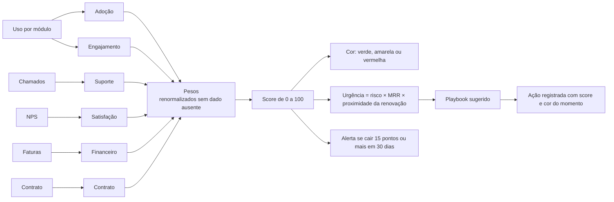

# 10 · Regras analíticas do score

[Índice](README.md) · Anterior: [Evolução e roadmap](09-evolucao-e-roadmap.md) · Fonte das fórmulas: [metodologia](../03-metodologia-do-score/README.md), [regras de negócio](../02-definicao/02-regras-de-negocio.md) e `src/lib/score/dimensions.ts` (`PARAMS`)

Esta página explica o cálculo em linguagem de negócio, na ordem em que ele acontece. Pesos, janelas e penalidades correspondem às constantes nomeadas no código. Termos: [glossário](../GLOSSARIO.md).

## Do dado à ação

## As seis dimensões

Cada dimensão vai de 0 a 100 (maior é mais saudável). O peso padrão e a janela de dados:

| Dimensão | Peso | O que mede | Como é calculada | Janela |
|---|---:|---|---|---|
| Adoção | 25 | Quantos dos 5 módulos a conta usa | Módulos com 4 ou mais eventos ÷ 5 × 100 | 30 dias |
| Engajamento | 20 | Frequência e tendência de uso | 70% frequência (dias ativos ÷ 20, no máximo 1) + 30% tendência (volume atual ÷ volume anterior; razão 1 vale 100, razão 0,5 ou menos vale 0) | 30 dias contra os 30 anteriores |
| Suporte | 15 | Carga e repetição de chamados | 100 menos: 10 por chamado recente (teto 40), 15 por categoria repetida (teto 30), 20 por chamado crítico aberto (teto 40), 10 se algum aberto passa de 7 dias | 60 dias (recentes: 30) |
| Satisfação | 15 | NPS mais recente | 80% nota × 10 + 20% tendência (50 + 10 × variação de nota, de 0 a 100) | 180 dias |
| Financeiro | 15 | Atraso de pagamento | 100 menos: 10 por fatura paga com mais de 5 dias de atraso; 40 mais 1,5 por dia (acréscimo até 30) por fatura vencida e não paga | 90 dias |
| Contrato | 10 | Proximidade da renovação | 100 com 120 dias ou mais; cai linearmente até 40 no vencimento; vencido sem renovação vale 20 | — |

Por que esses pesos: adoção é o sinal mais cedo e mais acionável; engajamento captura o "esfriamento"; suporte, satisfação e financeiro indicam atrito, mas são ambíguos; contrato marca o momento de decisão, não a insatisfação. Os pesos são escolhas fundamentadas, não estimativas.

## Score, dado ausente e confiança

O score é a soma dos valores multiplicados pelos pesos, limitada a 0–100 e arredondada a uma casa. Dimensão sem dado (conta com menos de 30 dias; sem NPS em 180 dias; sem fatura vencida em 90 dias) sai do cálculo e os pesos das demais são renormalizados, em vez de virar nota 0. Com menos de 70% do peso disponível, a tela avisa **confiança baixa** (RN-08).

Exemplo de leitura, a partir do [print da explicação](../screenshots/04-explicacao-do-score.png) da conta Cargas Martins (dados sintéticos):

| Dimensão | Valor | Peso usado | Contribuição |
|---|---:|---:|---:|
| Adoção | 20,0 | 25% | 5,0 |
| Engajamento | 7,0 | 20% | 1,4 |
| Suporte | 45,0 | 15% | 6,8 |
| Satisfação | 42,0 | 15% | 6,3 |
| Financeiro | 20,0 | 15% | 3,0 |
| Contrato | 51,8 | 10% | 5,2 |

A soma das contribuições é 27,6, o score exibido (vermelho). Adoção e engajamento são os que mais puxam para baixo: 1 de 5 módulos em uso e 2 dias ativos nos últimos 30.

## Cor

Padrão: verde a partir de 75, amarelo de 50 a 74,9, vermelho abaixo de 50. Os limites são configuráveis pelo Admin, com simulação antes de salvar.

## Urgência e priorização

Urgência = (100 − score) ÷ 100 × MRR × proximidade da renovação (RN-11). A proximidade vai de 1 (renovação a 90 dias ou mais) a 2 (vence hoje ou já venceu). O score diz quão saudável a conta está; a urgência diz por onde começar, porque cada CSM conduz cerca de 15 contatos por semana. No exemplo, a conta tem risco de 72%, MRR de R$ 1.938 e renovação em 24 dias, e a tela mostra urgência de R$ 2.440. A lista de risco ordena por urgência, e o índice 0–100 da barra é a urgência dividida pela maior da lista.

## Playbooks (RN-12)

| Playbook | Gatilho |
|---|---|
| Baixa adoção | Adoção abaixo de 50 (menos de 3 dos 5 módulos) |
| Queda de uso | Volume dos últimos 30 dias abaixo de 70% do período anterior |
| Chamados repetidos | Categoria com 2 ou mais chamados em 60 dias, chamado crítico aberto ou 3 ou mais chamados em 30 dias |
| NPS baixo | Última nota de 6 ou menos, ou queda de 3 pontos ou mais |
| Renovação próxima | Renovação em 90 dias ou menos, ou contrato vencido |

Cada playbook traz objetivo, passos, roteiro de contato, modelo de mensagem preenchido com a conta e o CSM, critério de sucesso e condição para escalar. O roteiro nunca pergunta "está tudo bem?", por causa da reunião 3.

## Alerta de queda brusca (v1.1.0)

Dispara quando a variação do score em 30 dias é de −15 pontos ou pior (`SUDDEN_DROP_POINTS`, RN-17), com a mesma configuração dos dois lados da comparação, e identifica a dimensão que mais pesou. Alerta pela velocidade da queda, não pela cor.

## O que é calculado e o que não é validado

| Natureza | Itens |
|---|---|
| Indicadores calculados | Score, cor, urgência, variação de 30 dias, contribuição por dimensão, alertas de queda, correlação de Spearman entre cenários |
| Hipóteses não validadas | Que o score anteceda cancelamento; que ordenar por urgência reduza o tempo de decisão (H-01) ou os cancelamentos (H-04); que os pesos padrão sejam os melhores |
| Fora do que o sistema afirma | Probabilidade de cancelamento: o pedido foi [recusado](../04-arquitetura/04-wireframes-e-validacao.md) por falta de histórico para calibrar |

O score não captura motivo qualitativo, concorrência, relacionamento, gravidade real dos chamados, uso por veículo, sazonalidade, valor estratégico além do MRR nem causalidade ([lista completa](../03-metodologia-do-score/README.md#8-o-que-o-score-não-captura)). Os dados são sintéticos e a análise de sensibilidade mede estabilidade (ordem das contas estável nos 19 cenários de peso, com Spearman de 0,936 a 0,998), não precisão.
