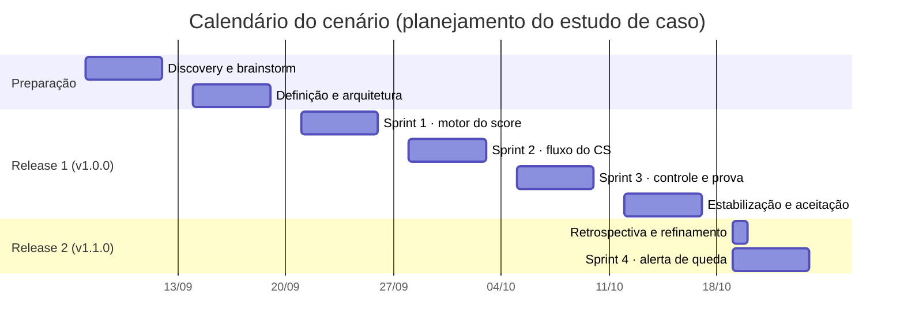
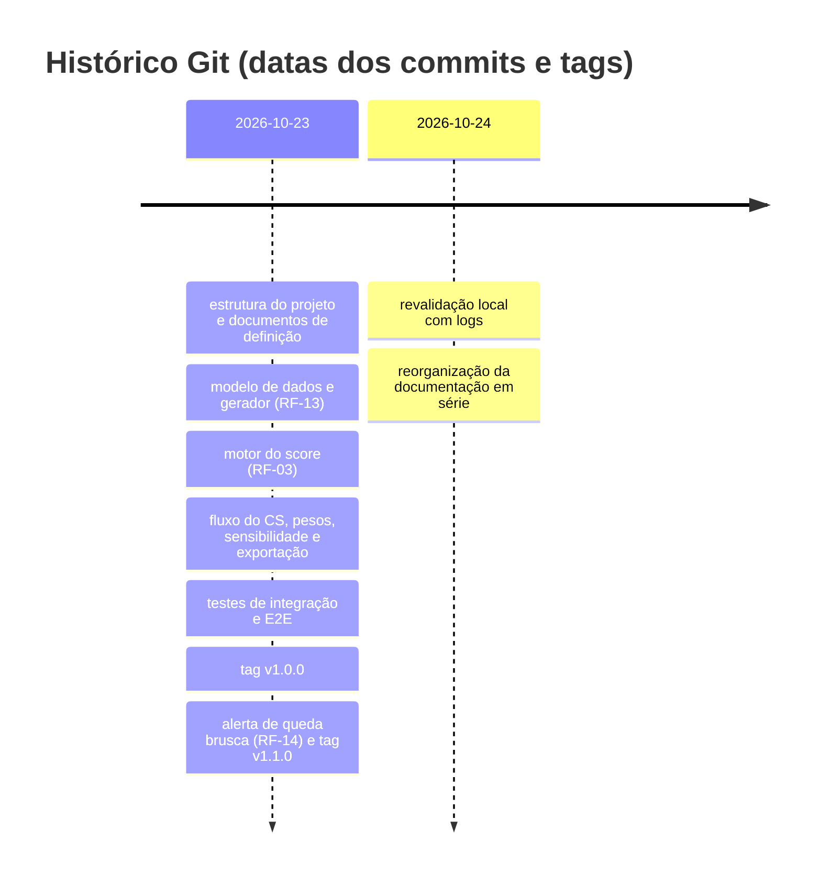

# Ciclo de vida do Termômetro

Relatório do ciclo de vida do projeto, da descoberta do problema à evolução da versão 1.1.0. Cada página liga problema, requisito, decisão, implementação, teste e resultado, e remete aos documentos de origem em vez de copiá-los. Voltar ao [README](../../README.md) · [guia da série](../INDEX.md) · [glossário](../GLOSSARIO.md).

## Como ler as evidências

| Tipo | O que é | Exemplos |
|---|---|---|
| Observado | Confirmado no repositório ou em execução registrada, com commit e data | Código, testes, logs em `docs/05-qualidade/`, tags `v1.0.0` e `v1.1.0` |
| Planejamento do cenário | Calendário, sprints, cerimônias e atas elaborados para compor o estudo de caso | [Sprints](sprints/), [reuniões](reunioes/README.md) |
| Ilustrativo | Número ou análise apresentado só para exemplificar | Nenhum número de desempenho do negócio; os dados de uso são sintéticos |

A nota de contexto sobre a natureza do material está no [fim do README](../../README.md#nota-de-contexto-acadêmico).

## Documentos

| # | Documento | O que responde |
|---|---|---|
| 01 | [Visão e discovery](01-visao-e-discovery.md) | Qual é o problema, para quem e como o sucesso será julgado |
| 02 | [Planejamento e Scrum](02-planejamento-e-scrum.md) | Como o trabalho foi dividido em releases e sprints |
| 03 | [Requisitos e rastreabilidade](03-requisitos-e-rastreabilidade.md) | Como a necessidade virou requisito, regra, código e teste |
| 04 | [Arquitetura e ADRs](04-arquitetura-e-adrs.md) | Como o sistema é organizado e por que |
| 05 | [Modelo de dados](05-modelo-de-dados.md) | Entidades, dicionário, esquema estrela e o valor 1.355 |
| 06 | [Desenvolvimento e configuração](06-desenvolvimento-e-configuracao.md) | Branches, commits, versões e o que existe de automação |
| 07 | [Testes e qualidade](07-testes-e-qualidade.md) | O que foi testado, executado e o que não foi medido |
| 08 | [Implantação e operação](08-implantacao-e-operacao.md) | O que existe e o que seria preciso para operar |
| 09 | [Evolução e roadmap](09-evolucao-e-roadmap.md) | De v1.0.0 para v1.1.0 e o que vem depois |
| 10 | [Regras analíticas do score](10-regras-analiticas-do-score.md) | Como o score e a urgência são calculados |
| — | [Reuniões e solicitações](reunioes/README.md) · [Sprints](sprints/README.md) · [Diagramas](diagramas/README.md) | Registros de apoio |

## Linha do tempo

Calendário do cenário, em planejamento. As datas de sprint não correspondem às datas dos commits.

Marcos observados no Git:

O histórico mostra a execução técnica concentrada em 2026-10-23; o calendário acima organiza o cenário e não pretende reconstruir essa cronologia.
