# Diagramas

[Índice](../README.md)

Os diagramas do ciclo de vida são escritos em Mermaid dentro das próprias páginas, onde o GitHub os renderiza. Esta pasta guarda a fonte editável (`.mmd`) e uma imagem exportada (`.png`) de cada um, gerados a partir dos blocos Mermaid do [README](../../../README.md) e das páginas do [ciclo de vida](../README.md). As imagens são renderizações dos diagramas, não capturas da interface do produto.

| Imagem | Fonte | O que mostra |
|---|---|---|
| 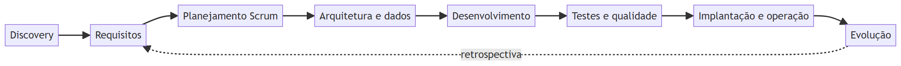 | README | Fases do ciclo de vida e o laço de retrospectiva |
|  | README | Rastreabilidade em resumo |
| 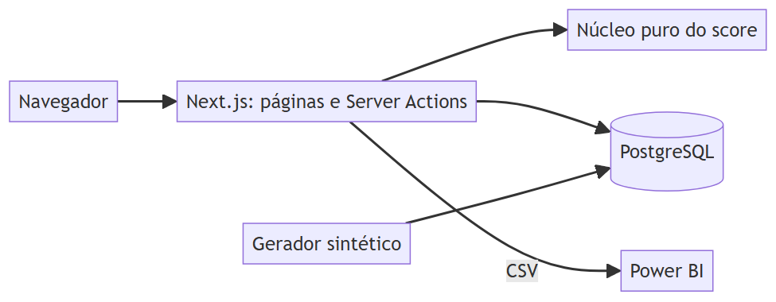 | README | Arquitetura em resumo |
| 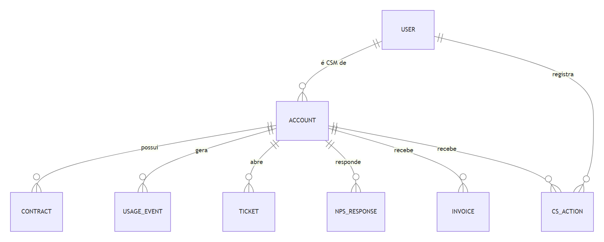 | README | Modelo ER em resumo |
| 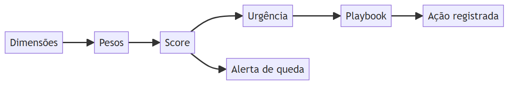 | README | Fluxo principal |
| 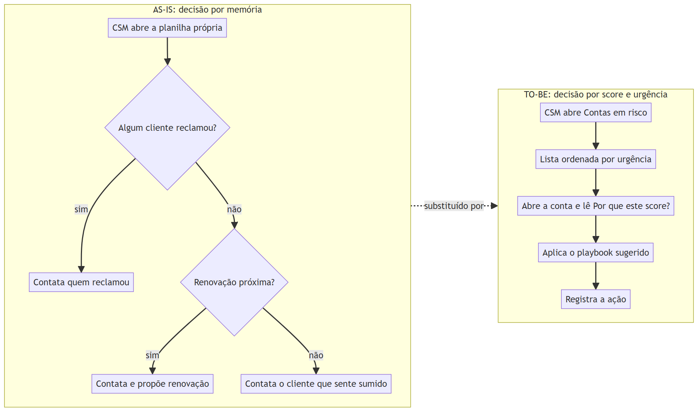 | [01 Visão](../01-visao-e-discovery.md) | Fluxo de negócio antes e depois |
| 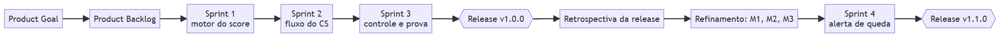 | [02 Scrum](../02-planejamento-e-scrum.md) | Fluxo de planejamento |
|  | [03 Requisitos](../03-requisitos-e-rastreabilidade.md) | Cadeia de rastreabilidade |
| 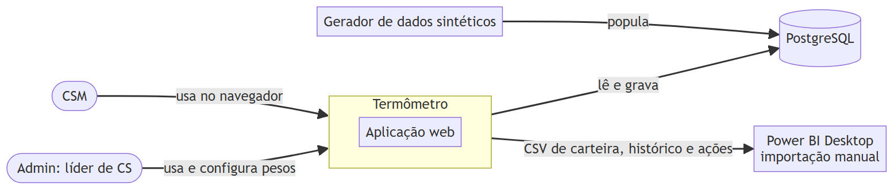 | [04 Arquitetura](../04-arquitetura-e-adrs.md) | Contexto do sistema |
| 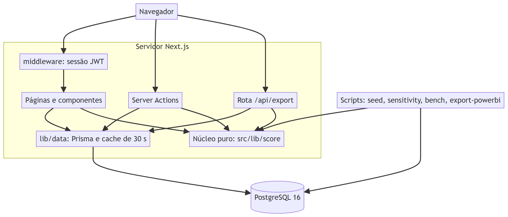 | [04 Arquitetura](../04-arquitetura-e-adrs.md) | Contêineres |
| 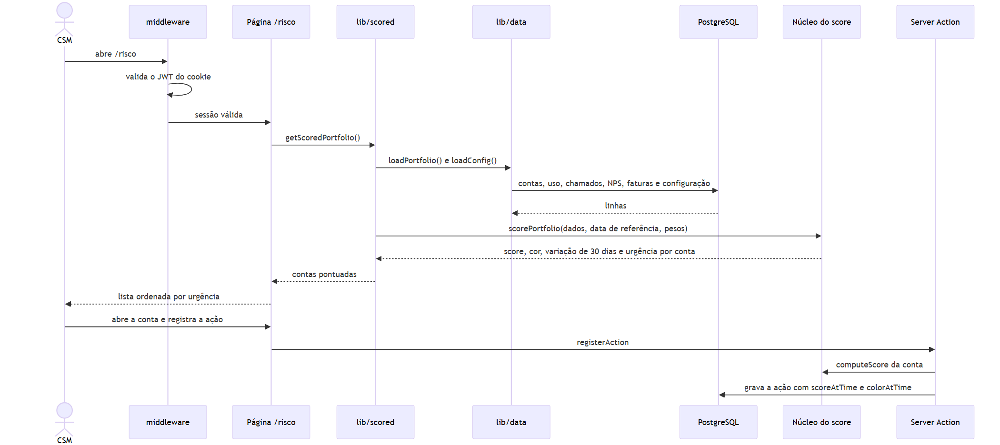 | [04 Arquitetura](../04-arquitetura-e-adrs.md) | Sequência do fluxo principal |
| 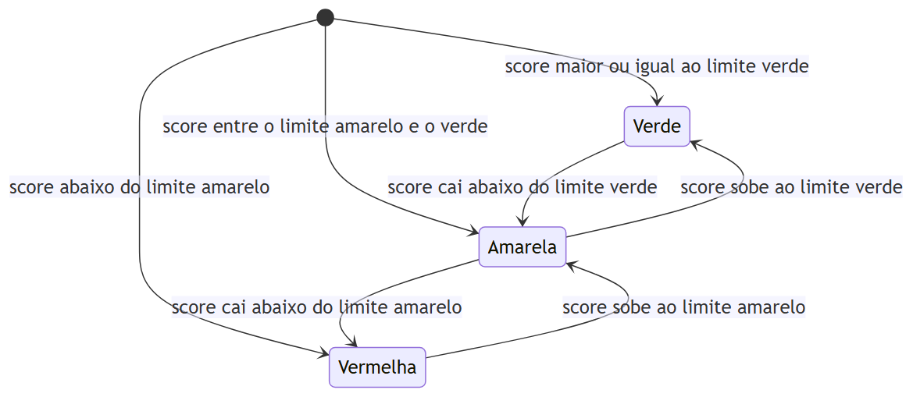 | [04 Arquitetura](../04-arquitetura-e-adrs.md) | Estados da cor |
| 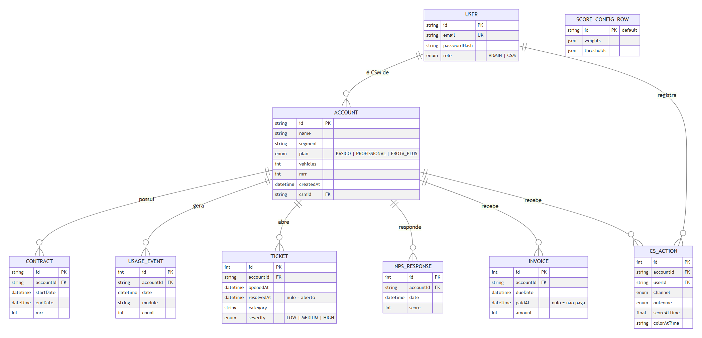 | [05 Modelo de dados](../05-modelo-de-dados.md) | Modelo ER |
| 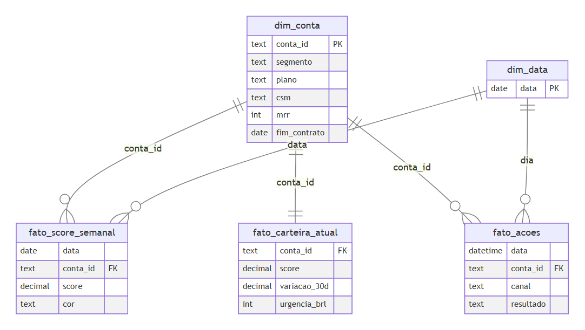 | [05 Modelo de dados](../05-modelo-de-dados.md) | Esquema estrela |
| 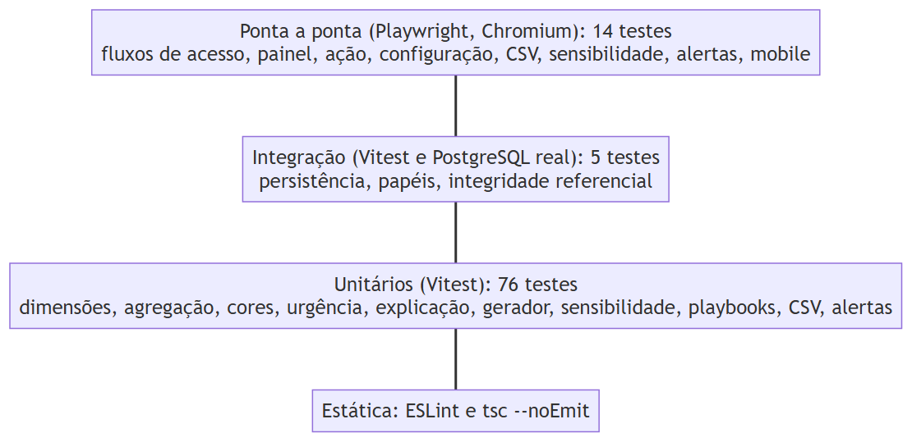 | [07 Testes](../07-testes-e-qualidade.md) | Pirâmide de testes |
| 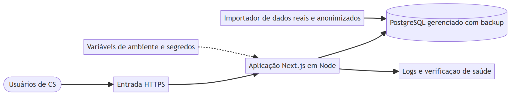 | [08 Implantação](../08-implantacao-e-operacao.md) | Arquitetura de implantação planejada |
| 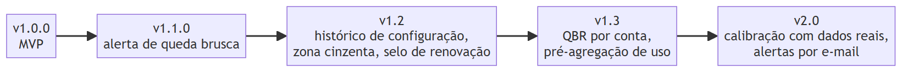 | [09 Evolução](../09-evolucao-e-roadmap.md) | Roadmap |
| 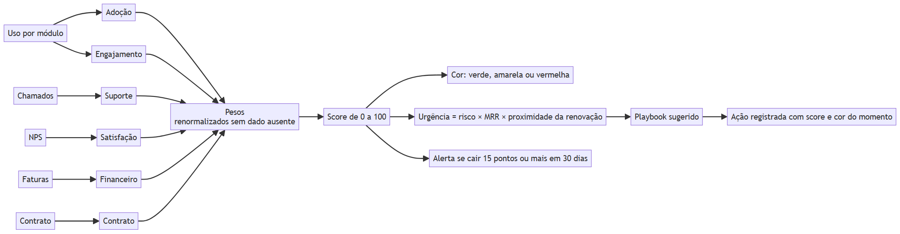 | [10 Regras do score](../10-regras-analiticas-do-score.md) | Pipeline analítico |
| 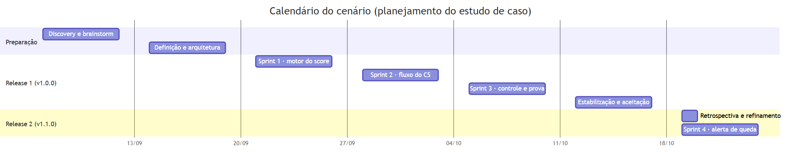 | [Índice](../README.md) | Calendário do cenário (planejamento) |
| 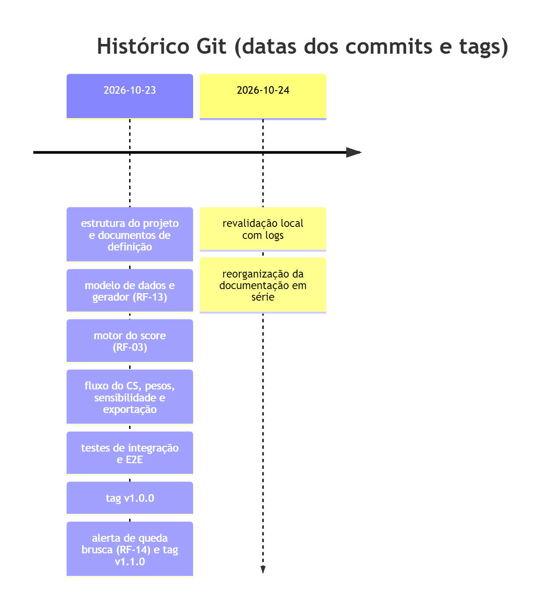 | [Índice](../README.md) | Histórico Git |

Para regenerar as imagens, renderize os blocos Mermaid das páginas com a ferramenta de sua preferência; as fontes `.mmd` desta pasta são as entradas.
