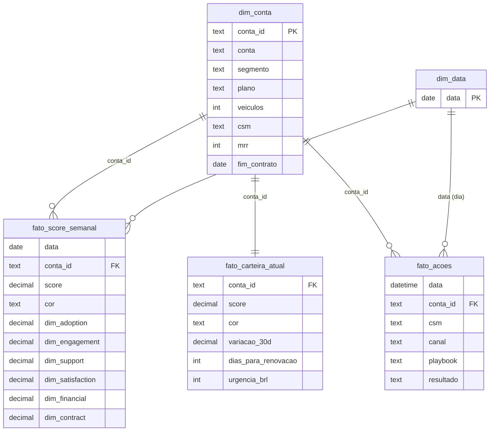

# Complemento para Power BI

> O Claude Code **não gera o arquivo `.pbix`**. Este guia entrega os CSVs, o modelo de dados, as medidas DAX e um passo a passo para eu montar o relatório e tirar os prints em [`docs/screenshots/powerbi/`](../docs/screenshots/powerbi/).
> Os dados são **sintéticos**. Os prints do Power BI ainda **não existem**: a pasta tem só um `.gitkeep` e eu os adiciono depois de montar o relatório.

## 1. Arquivos de dados
Gerados por `npm run export:powerbi` (sem banco, a partir do gerador com a semente fixa) em [`powerbi/data/`](data/):

| Arquivo | Linhas | Conteúdo |
|---|---:|---|
| `dim_conta.csv` | 120 | Cadastro da conta: segmento, plano, veículos, cidade, CSM, MRR, fim do contrato |
| `fato_score_semanal.csv` | 1.355 | Score, cor e as 6 dimensões por conta e semana (12 semanas) |
| `fato_carteira_atual.csv` | 120 | Score atual, cor, variação em 30 dias, dias para renovar e urgência |
| `fato_acoes.csv` | 64 | Ações do CS: data, conta, CSM, canal, playbook, resultado |

Alternativa: exportar pelo sistema (`/api/export?tipo=carteira|historico|acoes`) depois de entrar no painel; os nomes de coluna dessa exportação são parecidos, mas não idênticos. Neste guia uso os CSVs de `powerbi/data`.

Formato: UTF-8 com BOM, separador vírgula, ponto decimal. Se o Power BI não reconhecer números, use **Transformar dados → Alterar tipo → Usando localidade… → Inglês (Estados Unidos)**.

## 2. Modelo de dados (esquema em estrela)



Relacionamentos (todos 1 para muitos, filtro de `dim_*` para `fato_*`, direção única): `dim_conta[conta_id]` → `fato_score_semanal[conta_id]`, `fato_carteira_atual[conta_id]` (1:1), `fato_acoes[conta_id]`; `dim_data[data]` → `fato_score_semanal[data]`. Para `fato_acoes`, crie a coluna calculada `dia = DATE(fato_acoes[data])` e relacione com `dim_data[data]`.

`dim_data` é criada no Power BI (Modelagem → Nova tabela):
```dax
dim_data = CALENDAR ( DATE ( 2026, 1, 1 ), DATE ( 2026, 12, 31 ) )
```

## 3. Medidas DAX

```dax
-- Contas (na semana mais recente ou na seleção de data)
Contas = DISTINCTCOUNT ( fato_score_semanal[conta_id] )

Ultima Semana = MAX ( fato_score_semanal[data] )

Score Medio =
CALCULATE (
    AVERAGE ( fato_score_semanal[score] ),
    fato_score_semanal[data] = [Ultima Semana]
)

Contas Criticas =
CALCULATE (
    DISTINCTCOUNT ( fato_score_semanal[conta_id] ),
    fato_score_semanal[data] = [Ultima Semana],
    fato_score_semanal[cor] = "RED"
)

Contas Atencao =
CALCULATE (
    DISTINCTCOUNT ( fato_score_semanal[conta_id] ),
    fato_score_semanal[data] = [Ultima Semana],
    fato_score_semanal[cor] = "YELLOW"
)

MRR Total = SUM ( dim_conta[mrr] )

MRR em Risco =
SUMX (
    FILTER ( fato_carteira_atual, fato_carteira_atual[cor] = "RED" ),
    RELATED ( dim_conta[mrr] )
)

Pct MRR em Risco = DIVIDE ( [MRR em Risco], [MRR Total] )

Urgencia Total = SUM ( fato_carteira_atual[urgencia_brl] )

Queda Brusca (>= 15 pts) =
CALCULATE (
    COUNTROWS ( fato_carteira_atual ),
    fato_carteira_atual[variacao_30d] <= -15
)

Acoes Registradas = COUNTROWS ( fato_acoes )

Pct Acoes Resolvidas =
DIVIDE (
    CALCULATE ( COUNTROWS ( fato_acoes ), fato_acoes[resultado] = "RESOLVIDO" ),
    [Acoes Registradas]
)
```

Observação: `MRR em Risco` usa `RELATED`, que exige o relacionamento `fato_carteira_atual` → `dim_conta` (muitos para um/um para um) ativo.

## 4. Passo a passo para montar o relatório

1. **Obter dados**: Power BI Desktop → *Obter dados* → *Texto/CSV* → selecione os 4 arquivos de `powerbi/data` → *Transformar dados*.
2. **Tipos**: em `fato_score_semanal`, `data` como Data; `score` e `dim_*` como Número decimal. Em `fato_acoes`, `data` como Data/Hora. Adicione a coluna `dia`.
3. **Modelo**: crie `dim_data`, monte os relacionamentos da seção 2 (aba *Modelo*).
4. **Medidas**: *Nova medida* para cada fórmula da seção 3 (em uma tabela `_Medidas` vazia, por organização).
5. **Página 1 · Visão executiva**: cartões com `Score Medio`, `Contas Criticas`, `MRR em Risco`, `Pct MRR em Risco`; gráfico de rosca de `fato_carteira_atual[cor]` por contagem; gráfico de linhas de `fato_score_semanal[data]` × `Contas` com legenda `cor`; barras empilhadas por `dim_conta[segmento]` com legenda `cor` (semana mais recente).
6. **Página 2 · Contas em risco**: tabela com `conta`, `csm`, `score`, `cor`, `variacao_30d`, `dias_para_renovacao`, `urgencia_brl`; filtre `cor ≠ GREEN`; ordene por `urgencia_brl` decrescente; formatação condicional da coluna `cor`.
7. **Página 3 · Ações do CS**: `Acoes Registradas`, `Pct Acoes Resolvidas`, barras por `resultado` e por `playbook`; segmentação por `csm`.
8. **Formatação**: cores consistentes com o sistema (verde `#15803d`, amarelo `#d97706`, vermelho `#b91c1c`); sempre rótulo textual além da cor.
9. **Prints**: exiba cada página em tela cheia e salve em [`docs/screenshots/powerbi/`](../docs/screenshots/powerbi/) como `01-visao-executiva.png`, `02-contas-em-risco.png`, `03-acoes-do-cs.png`.
10. **Conferência**: os valores devem bater com o sistema na data de referência: **11 contas críticas, 40 em atenção, 69 saudáveis**, score médio **77,2** e **MRR crítico R$ 7.234** (configuração padrão). Se não batem, revise tipos e relacionamentos.

## 5. Limitações
- O `.pbix` não está no repositório (não foi gerado).
- Os CSVs são um retrato fixo; para atualizar, rode `npm run export:powerbi` de novo.
- `fato_score_semanal` usa a configuração padrão de pesos; se você mudar os pesos no sistema, exporte pela API para refletir.
